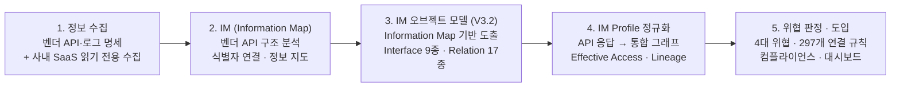

# AEGI Framework

**AEGI Framework**는 여러 SaaS에 흩어진 계정, 권한, 연동, 자동화, 감사 로그를 단일 그래프 모델로 통합해 Cross-SaaS 보안 위협과 컴플라이언스를 판정하는 **기업 도입용 통합 프레임워크 및 실행 패키지**다.

이 저장소는 단순 실행용 솔루션이 아니라, **벤더 명세·테넌트 수집 → IM(Information Map) 도출 → IM 오브젝트 모델 정의 → IM Profile 정규화 → 위협 판정·대시보드 실행**까지 AEGI의 전체 방법론·규격·도구·런타임을 하나로 제공한다. 기업 보안팀과 엔지니어는 원리를 투명하게 검토하고, 바로 실행하거나 자사 SaaS 환경에 맞춰 확장할 수 있다.

---

## 전체 파이프라인



---

## 핵심 개념 한눈에 보기

AEGI는 벤더마다 제각각인 API와 권한 체계를 하나의 기준으로 묶기 위해 아래 핵심 개념과 원칙을 사용한다.

- **IM (Information Map, 정보 지도)**
  SaaS마다 다른 API 문서(OpenAPI, GraphQL 등)의 요청·응답 구조를 분석해, **어떤 API가 어떤 대상을 다루고 어떤 ID 필드가 같은 실체를 가리키는지(ID 공간)** 정리한 지도다. 사람이 감으로 스키마를 설계하지 않고 벤더 공식 명세에서 객관적으로 모델을 도출하기 위한 출발점이며, 아래의 **IM 오브젝트 모델**과 **IM Profile**은 모두 이 정보 지도(IM)를 바탕으로 만들어져 `IM`이라는 이름을 공유한다.
- **IM 오브젝트 모델 (IM Object Model V3.2)**
  Information Map에서 도출한 AEGI의 표준 오브젝트 모델(현행 고정본 **V3.2**)이다. 여러 SaaS의 계정·권한·자원·연동·자동화를 벤더에 무관한 하나의 언어로 통합하며, 모든 객체를 **Interface 9종**(역할 태그: `Principal`, `Credential`, `Resource`, `Automation` 등)과 **Relation 17종**(객체 간 사실 관계)으로 표준화한다.
- **IM Profile (정규화 계약)**
  실제 기업 테넌트에서 수집한 원본 API 응답을 IM 오브젝트 모델의 객체(`Object`), 사실 관계(`Relation`), Cross-SaaS 동일인·동일 자동화 연결(`Link`)로 변환하는 선언적 매핑 규칙이다.
- **Effective Access (실질 접근 권한)**
  그룹 상속이나 자동화 실행 위임 등을 합성해 **"누가 실제로 무엇에 접근할 수 있는가"**를 계산한 결과다.
- **수집 누락으로 인한 잘못된 판단 방지**
  권한 부족이나 API 오류로 못 읽은 영역은 별도로 기록해(`coverage.json`), 수집 누락을 "접근 권한 없음"이나 "컴플라이언스 통과"로 잘못 판단하지 않는다.

---

## 저장소 구성

| 경로 | 역할 | 주요 내용 |
| --- | --- | --- |
| [`docs/`](docs/01-overview/architecture.md) | 프레임워크 안내서 | 아키텍처, 5단계 방법론, 기업 도입 가이드, 새 SaaS 추가 플레이북 |
| [`framework/schema/`](framework/schema/README.md) | 의미 규격 · 온톨로지 · IM 도출 | Object/Relation/Link/EA/Profile 규격, YAML 온톨로지, Information Map·IM 추출 도구 및 V3.2 고정본 |
| [`framework/connection-rules/`](framework/connection-rules/docs/methods.md) | Cross-SaaS 연결 확인 규칙 | 28개 SaaS 쌍, 297개 연결 검증 규칙(YAML) 및 인터랙티브 연결 지도(`connection-map.html`) |
| [`framework/threat-mapping/`](framework/threat-mapping/README.md) | SaaS 객체별 위협 매핑 | Okta, Google Workspace, GitHub, Slack, Salesforce, Atlassian, Microsoft 365, Gemini, 1Password, Snowflake 객체 위협 CSV 및 작성 규격 |
| [`framework/compliance/`](framework/compliance/scope/README.md) | 컴플라이언스 규격 | ISMS-P, PIPA, ISO 27001 대상 판정 기준 및 권고 가이드 |
| [`specs/`](specs/IM_PROFILE_PIPELINE.md) | 엔진 핵심 설계 명세 | IM Profile 파이프라인, 전수 수집, 위협 판정 V2, 범용 접근 엔진, 피해 범위(Blast Radius), 계보 |
| [`runtime/`](runtime/README.md) | 로컬 실행 런타임 | 클라우드·외부 DB 없이 한 PC에서 수집·정규화·판정·대시보드·AI 조사를 실행하는 통합 런타임 |
| [`scripts/`](scripts/check-public-safety.mjs) | 검증·유지보수 도구 | 외부 공개 안전성 검사, 링크 검사 |

---

## 목적별 시작하기

### 1. 방법론과 아키텍처 이해하기
1. [프레임워크 아키텍처](docs/01-overview/architecture.md)와 [전체 파이프라인](docs/01-overview/pipeline.md)
2. [01. 정보 수집(벤더 명세 및 테넌트 수집)](docs/02-methodology/01-metadata-collection.md)
3. [02. Information Map 도출(정보 지도 · ID 공간)](docs/02-methodology/02-ir-and-information-map.md)
4. [03. IM 모델과 오브젝트 도출(V3.2)](docs/02-methodology/03-im-object-modeling.md)
5. [04. IM Profile 정규화와 Effective Access](docs/02-methodology/04-profile-and-normalization.md)
6. [05. 위협 판정 · 연결 규칙 · 컴플라이언스](docs/02-methodology/05-threat-and-compliance.md)

### 2. 사내 환경에 바로 도입·실행하기 (9개 SaaS)
- **기본 수집·정규화·판정 지원 (9개)**: **Okta, Google Workspace, GitHub, Slack, Salesforce, Atlassian(Jira·Confluence), Microsoft 365(Entra ID), Google Cloud / Gemini Enterprise, 1Password**
- **Splunk 감사 로그 해석**: 기존 6개(Okta, Google Workspace, GitHub, Slack, Salesforce, Atlassian)만

- Windows: `runtime\start.cmd`
- macOS / Linux: `./runtime/start.sh`

상세 도입 절차는 [기업 도입 가이드](docs/03-enterprise-adoption/adoption-guide.md)와 [런타임 안내](runtime/README.md)를 따른다. SaaS별 최소 읽기 권한은 [수집 가이드](runtime/docs/saas-collection-guide.md)와 [권한 범위 표](runtime/docs/saas-adapter-scopes.md)에 정리되어 있다.

> `aegi-solution-0.1.0.zip`을 따로 받았다면, 그것은 SaaS 6개를 수집하는 이전 판이다. 이 저장소와 무엇이 다른지는 [aegi-solution 압축파일과의 차이](docs/03-enterprise-adoption/aegi-solution-zip.md)에 있다.

### 3. 자사 SaaS를 프레임워크에 새로 추가하기
지원 목록 외에 Workday 또는 사내 커스텀 SaaS를 추가하려면 [새 SaaS 추가 플레이북](docs/03-enterprise-adoption/adding-new-saas.md)을 따른다.

---

## 무결성 및 보안 검증

Node.js 22.13 이상 환경에서 아래 명령으로 프레임워크 무결성과 외부 배포 안전성을 확인할 수 있다.

```bash
npm run verify          # 안전성 검사 + 문서 링크 검사 + IM V3.2 고정본 무결성 검증
npm run check:safety    # 내부 전용 경로·개인 경로·시크릿 유출 여부 검사
npm run verify:freeze   # IM Object Model V3.2 (40개 파일) 해시 무결성 검증
npm run runtime:doctor  # 로컬 런타임 실행 환경 및 SaaS 자격증명 준비 상태 점검
```

보안 원칙(읽기 전용 API, 데이터 경계, 시크릿 비보관)은 [보안 및 데이터 보호 원칙](docs/03-enterprise-adoption/security-and-privacy.md)을 참고한다.
