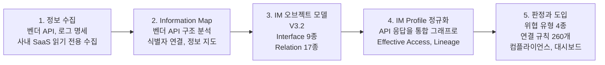

# AEGI Framework

여러 SaaS에 흩어진 계정, 권한, 연동, 자동화, 감사 로그를 **하나의 그래프 모델**로 모아 SaaS 경계를 넘는 보안 위협과 컴플라이언스 위반을 판정하는 기업 도입용 프레임워크이자 실행 패키지다.

벤더 명세와 테넌트 수집, Information Map 도출, IM 오브젝트 모델 정의, IM Profile 정규화, 위협 판정과 대시보드 실행까지 AEGI의 방법론, 규격, 도구, 런타임을 모두 이 저장소에 담았다. 보안팀과 엔지니어는 판정 근거가 되는 규칙과 명세를 직접 검토한 뒤 그대로 실행하거나 자사 SaaS 환경에 맞게 확장하면 된다.

## 파이프라인



## 핵심 개념

벤더마다 다른 API와 권한 체계를 하나의 기준으로 묶기 위해 아래 개념을 쓴다.

| 개념 | 정의 |
| --- | --- |
| **IM** (Information Map, 정보 지도) | SaaS마다 다른 API 문서(OpenAPI, GraphQL 등)의 요청과 응답 구조를 분석해 어떤 API가 어떤 대상을 다루고 어떤 ID 필드가 같은 실체를 가리키는지(ID 공간) 정리한 지도. 스키마를 감으로 설계하지 않고 벤더 공식 명세에서 모델을 도출하는 출발점이다. IM 오브젝트 모델과 IM Profile은 모두 이 지도를 바탕으로 만들어 `IM`이라는 이름을 공유한다 |
| **IM 오브젝트 모델** (V3.2) | Information Map에서 도출한 표준 오브젝트 모델. 현행 고정본은 V3.2다. 여러 SaaS의 계정, 권한, 자원, 연동, 자동화를 벤더와 무관한 하나의 언어로 표현한다. 모든 객체를 Interface 9종(역할 태그: `Principal`, `Credential`, `Resource`, `Automation` 등)과 Relation 17종(객체 사이의 사실 관계)으로 표준화한다 |
| **IM Profile** (정규화 계약) | 실제 테넌트에서 수집한 원본 API 응답을 객체(`Object`), 사실 관계(`Relation`), SaaS를 넘는 동일인과 동일 자동화 연결(`Link`)로 바꾸는 선언적 매핑 규칙 |
| **Effective Access** (실질 접근 권한) | 그룹 상속, 자동화 실행 위임 등을 합성해 **누가 실제로 무엇에 접근할 수 있는가**를 계산한 결과 |
| **수집 누락 기록** | 권한 부족이나 API 오류로 못 읽은 영역은 `coverage.json`에 따로 남긴다. 수집 누락을 「접근 권한 없음」이나 「컴플라이언스 통과」로 잘못 판정하지 않기 위해서다 |

## 저장소 구성

```text
aegi-framework/
├── docs/                          프레임워크 안내서
│   ├── 01-overview/               아키텍처, 전체 파이프라인
│   ├── 02-methodology/            단계별 방법론 5편
│   └── 03-enterprise-adoption/    도입 가이드, 새 SaaS 추가, 보안 원칙
├── framework/                     규격 본체
│   ├── schema/                    의미 규격과 온톨로지
│   │   ├── specs/                 Object, Relation, Link, Effective Access, Profile 규격
│   │   ├── ontology/              YAML 온톨로지
│   │   └── im-model/              Information Map, IM 추출 도구, V3.2 고정본
│   ├── connection-rules/          SaaS 쌍 21개, 연결 확인 규칙 260개, 연결 지도
│   ├── threat-mapping/            SaaS 객체별 위협 표
│   │                              Okta, Google Workspace, GitHub, Slack, Salesforce,
│   │                              Atlassian, Microsoft 365, Gemini, 1Password, Snowflake
│   └── compliance/                ISMS-P, PIPA, ISO 27001
│       ├── scope/                 대상 판정 기준
│       └── guidance/              권고 가이드
├── specs/                         엔진 설계 명세 7편
│                                  IM Profile 파이프라인, 전수 수집, 위협 판정 V2,
│                                  범용 접근 엔진, Blast Radius, 계보, 수집 자격증명
├── runtime/                       로컬 실행 런타임
│                                  클라우드나 외부 DB 없이 PC 한 대에서
│                                  수집, 정규화, 판정, 대시보드, AI 조사 실행
└── scripts/                       공개 안전성 검사, 링크 검사
```

폴더별 입구 문서: [docs](docs/01-overview/architecture.md), [schema](framework/schema/README.md), [connection-rules](framework/connection-rules/docs/methods.md), [threat-mapping](framework/threat-mapping/README.md), [compliance](framework/compliance/scope/README.md), [specs](specs/IM_PROFILE_PIPELINE.md), [runtime](runtime/README.md), [scripts](scripts/check-public-safety.mjs)

## 시작하기

### 방법론 검토

1. [프레임워크 아키텍처](docs/01-overview/architecture.md)와 [전체 파이프라인](docs/01-overview/pipeline.md)
2. [정보 수집](docs/02-methodology/01-metadata-collection.md): 벤더 명세와 테넌트 수집
3. [Information Map 도출](docs/02-methodology/02-ir-and-information-map.md): 정보 지도와 ID 공간
4. [IM 모델과 오브젝트 도출](docs/02-methodology/03-im-object-modeling.md): V3.2
5. [IM Profile 정규화와 Effective Access](docs/02-methodology/04-profile-and-normalization.md)
6. [위협 판정, 연결 규칙, 컴플라이언스](docs/02-methodology/05-threat-and-compliance.md)

### 사내 도입

| 구분 | SaaS |
| --- | --- |
| 수집, 정규화, 판정 (9개) | Okta, Google Workspace, GitHub, Slack, Salesforce, Atlassian(Jira, Confluence), Microsoft 365(Entra ID), Google Cloud / Gemini Enterprise, 1Password |
| Splunk 감사 로그 해석 (6개) | Okta, Google Workspace, GitHub, Slack, Salesforce, Atlassian |

아래 명령으로 런타임을 실행하세요.

- Windows: `runtime\start.cmd`
- macOS, Linux: `./runtime/start.sh`

도입 절차는 [기업 도입 가이드](docs/03-enterprise-adoption/adoption-guide.md)와 [런타임 안내](runtime/README.md)를 따르세요. SaaS별 최소 읽기 권한은 [수집 가이드](runtime/docs/saas-collection-guide.md)와 [권한 범위 표](runtime/docs/saas-adapter-scopes.md)에서 확인하세요.

### 새 SaaS 추가

Workday나 사내 자체 SaaS처럼 지원 목록에 없는 SaaS는 [새 SaaS 추가 플레이북](docs/03-enterprise-adoption/adding-new-saas.md)을 따르세요.

## 무결성과 배포 안전성 검증

Node.js 22.13 이상에서 아래 명령으로 확인하세요.

```bash
npm run verify          # 아래 안전성 검사, 문서 링크 검사, V3.2 고정본 검증을 한 번에
npm run check:safety    # 내부 전용 경로, 개인 경로, 시크릿 유출 검사
npm run verify:freeze   # IM Object Model V3.2 고정본 40개 파일 해시 검증
npm run runtime:doctor  # 로컬 런타임 실행 환경과 SaaS 자격증명 준비 상태 점검
```

읽기 전용 API, 데이터 경계, 시크릿 비보관 원칙은 [보안 및 데이터 보호 원칙](docs/03-enterprise-adoption/security-and-privacy.md)에 정리했다.
