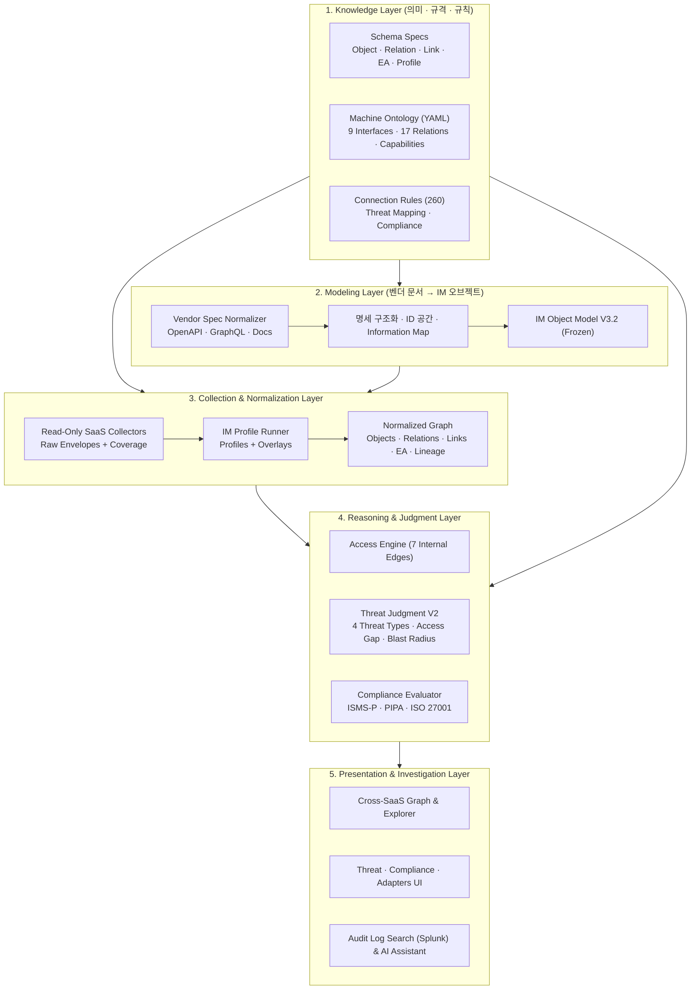

# AEGI Framework 아키텍처

AEGI Framework는 **지식(Knowledge)**, **모델 도출(Modeling)**, **수집·정규화(Collection & Normalization)**, **추론·판정(Reasoning & Judgment)**, **시각화·조사(Presentation & Investigation)**의 5개 논리 계층으로 나뉜다. 특정 클라우드나 상용 DB에 종속되지 않도록 계층 간 데이터 계약을 표준 파일·JSON·SQLite 인터페이스로 분리했다.

## 논리 계층 구조

## 계층별 책임과 데이터 경계

| 계층 | 저장소 위치 | 입력 | 출력 | 핵심 원칙 |
| --- | --- | --- | --- | --- |
| **Knowledge** | `framework/schema/`, `connection-rules/`, `threat-mapping/`, `compliance/` | 보안 표준, 벤더 공식 문서 | 닫힌 어휘(YAML), 규격 문서, 검증 규칙 | 특정 기업·테넌트 데이터를 포함하지 않는 범용 정본 |
| **Modeling** | `framework/schema/im-model/` | OpenAPI, GraphQL SDL, API 문서 | Information Map, IM Object Model V3.2 | 결정론적 추출(동일 입력 → 바이트 단위 동일 출력) |
| **Collection & Normalization** | `runtime/engine/` | SaaS 읽기 전용 API, IM V3.2, Profile | `objects.json`, `relations.json`, `links.json`, `effective_access.json`, `coverage.json`, `lineage_events.json` | 단일 IM Profile 파이프라인, 실패 응답은 객체 미생성, 수집 누락은 `coverage`로 보존 |
| **Reasoning & Judgment** | `runtime/engine/src/detection/` | 정규화 그래프 + `coverage` | 위협 목록(4유형), Access Gap, Blast Radius, 컴플라이언스 판정 | 사실(`Relation`)과 추론(`Link`, `EA`)의 저장·질의 분리 |
| **Presentation & Investigation** | `runtime/dashboard/`, `runtime/src/` | SQLite 스냅샷, (선택) Splunk 검색 REST, AI API | 웹 대시보드, 경로 탐색, 예외 관리, AI 질의 | 모든 데이터는 도입 기업 로컬/사내 저장소에만 유지 |

## 기업 배포 모델

AEGI Framework의 런타임(`runtime/`)은 도입 규모와 보안 정책에 따라 세 가지 형태로 활용할 수 있다.

1. **단일 워크스테이션(로컬 설치판)**: Node.js 22.13+와 내장 SQLite(`data/aegi.sqlite`)만으로 즉시 실행한다. 외부 서버나 클라우드 DB가 필요 없다.
2. **사내 전용 서버(On-Premise / Private VPC)**: `AEGI_HOST=0.0.0.0`과 `AEGI_PASSWORD`를 설정해 사내 보안팀 공용 서버로 운영하며, 사내 Splunk 검색 REST API와 연동한다.
3. **파이프라인·SIEM 통합(Headless)**: 대시보드 없이 `framework/`의 온톨로지·연결 규칙·위협 매핑과 `runtime/`의 수집·정규화·판정 CLI만 사내 CI/CD나 SOAR 파이프라인에 통합한다.

## 관련 문서

- [전체 파이프라인 상세](pipeline.md)
- [기업 도입 가이드](../03-enterprise-adoption/adoption-guide.md)
- [보안 및 데이터 보호 원칙](../03-enterprise-adoption/security-and-privacy.md)
