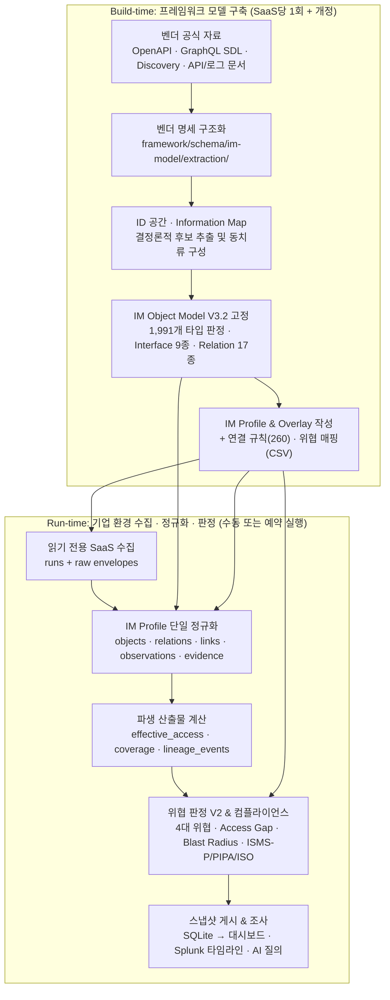

# 엔드투엔드 파이프라인

AEGI는 SaaS 보안 데이터를 단순히 API 응답 그대로 쌓지 않고, **모델링 파이프라인(Build-time)**과 **수집·판정 파이프라인(Run-time)**의 두 축으로 나누어 처리한다.

## 단계별 입력·처리·산출물

| 단계 | 구분 | 핵심 입력 | 주요 도구/규격 | 산출물 | 상세 문서 |
| --- | --- | --- | --- | --- | --- |
| **1. 정보 수집** | Build / Run | 벤더 API·로그 문서 / SaaS 읽기 전용 토큰 | `normalize_*.py`, Total Collector | 벤더 원자료 스냅샷 / `runs/`, `raw/` 봉투 | [01-metadata-collection.md](../02-methodology/01-metadata-collection.md) |
| **2. Information Map 도출** | Build | 벤더 원자료 | `extract.py`, `info_map.py`, `ir2/map3.py` | 구조화 명세(`ir/*.jsonl`), ID 공간, `info_map.html` | [02-ir-and-information-map.md](../02-methodology/02-ir-and-information-map.md) |
| **3. IM 모델 도출** | Build | Information Map, 온톨로지, 실측 근거 | `ir2/model_v1.py`, `extraction/r1/`, `verify-freeze.mjs` | IM Object Model V3.2 (`model/v3.2/`) | [03-im-object-modeling.md](../02-methodology/03-im-object-modeling.md) |
| **4. Profile 정규화** | Run | 완료된 수집 run + IM V3.2 + Profile/Overlay | `profile-binding/runner/normalize.mjs` | `objects.json`, `relations.json`, `links.json`, `effective_access.json`, `coverage.json`, `lineage_events.json` | [04-profile-and-normalization.md](../02-methodology/04-profile-and-normalization.md) |
| **5. 위협·컴플라이언스** | Run | 정규화 데이터셋 + 연결 규칙 + (선택) Splunk 로그 | `computeSnapshot`, `AccessEngine`, Threat V2 | 4대 위협, Access Gap, Blast Radius, 컴플라이언스 판정 | [05-threat-and-compliance.md](../02-methodology/05-threat-and-compliance.md) |

## 왜 Build-time과 Run-time을 분리했는가

- **재현성과 투명성**: 어떤 API 응답 필드가 왜 특정 Object와 Interface로 분류되는지 코드에 숨겨두지 않고, 벤더 공식 문서 → Information Map → IM V3.2 고정본으로 추적할 수 있다.
- **불완전 수집의 안전한 처리**: 기업 테넌트마다 권한·요금제 차이로 일부 API가 실패하거나 누락될 수 있다. AEGI는 실패 응답을 객체로 만들지 않고 `coverage.json`에 기록해, **수집 누락을 "권한 없음"으로 오판하지 않도록** 설계했다.
- **새 SaaS 확장의 표준화**: 새로운 SaaS를 도입할 때도 엔진 코어를 수정하는 대신 동일한 5단계 절차로 Information Map → IM → Profile → 위협 매핑을 추가할 수 있다. ([새 SaaS 추가 플레이북](../03-enterprise-adoption/adding-new-saas.md))
