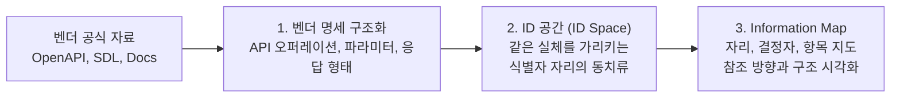

# 02. Information Map과 ID 공간 도출

벤더마다 API 문서 형식(OpenAPI, GraphQL SDL, HTML, PDF)과 용어가 다르다. AEGI는 벤더 종속성을 없애고 어떤 필드가 같은 대상을 가리키는지 밝히려고 **벤더 명세 구조화, ID 공간(ID Space), Information Map(정보 지도)** 순서의 결정론적 도출 3단계를 거친다.

## 1. 결정론적 추출 원칙

- 추출기는 자연어 `description`에 의존하지 않는다. **스키마 구조, 경로, 파라미터, 응답 형태(shape)** 같은 구조적 근거만 읽는다.
- 같은 입력과 같은 사전(`lexicons/`)이면 출력이 바이트 단위로 동일하다.
- 구조만으로 판단이 서지 않는 항목은 임의로 추측하지 않고 `queue.jsonl` 대기열로 보내 사람의 명시적 결정을 기록한다.

## 2. 3단계 도출 흐름



### 1단계 벤더 명세 구조화 (IR: Intermediate Representation)
벤더별 `normalize_<provider>.py`와 `ir2/norm_<provider>.py`가 각 API의 오퍼레이션(경로, 메서드), 요청 파라미터, 응답 shape, 감사 이벤트 유형을 공통 중간 표현(IR, Intermediate Representation) JSONL 형식(`ir/*.jsonl`)으로 변환한다.
- 상세 설계 문서: [IR 설계.md](../../framework/schema/im-model/design/IR%20설계.md)
- 구현 코드: [ir2/ir_schema.py](../../framework/schema/im-model/extraction/ir2/ir_schema.py), [ir2/README.md](../../framework/schema/im-model/extraction/ir2/README.md)

### 2단계 ID 공간
서로 다른 API의 응답과 요청 파라미터에 등장하는 식별자 자리(예: `users.list`의 `id`, `groups.members`의 `user_id`, 경로 파라미터 `{userId}`) 중 **스키마 근거로 같은 대상을 가리키는 자리들을 동치류(Equivalence Class)**로 묶는다.
- 설계 문서: [ID 공간 설계.md](../../framework/schema/im-model/design/ID%20공간%20설계.md)
- 대조 결과: [ID 공간 오브젝트 대조.md](../../framework/schema/im-model/design/ID%20공간%20오브젝트%20대조.md)

### 3단계 Information Map
사람이 미리 만든 사전에 의존하지 않고, 구조화된 API 명세와 ID 공간의 근거만으로 SaaS 내부의 **자리(Slot), 결정자(Determinant), 항목(Item)** 관계를 지도로 구성한다. 이 지도로 어떤 API가 어떤 오브젝트를 생성하거나 조회하는지, 어떤 필드가 다른 오브젝트를 참조하는지 검증한다.
- 설계 문서: [정보 지도 설계.md](../../framework/schema/im-model/design/정보%20지도%20설계.md), [Information Map 설계.md](../../framework/schema/im-model/design/Information%20Map%20설계.md)
- 도출 도구: [extract.py](../../framework/schema/im-model/extraction/extract.py), [info_map.py](../../framework/schema/im-model/extraction/info_map.py), [ir2/map3.py](../../framework/schema/im-model/extraction/ir2/map3.py)

## 3. 도출 도구 실행 예시

`framework/schema/im-model/extraction/`의 Python 도구로 벤더 원자료에서 후보 추출과 정보 지도를 재현한다. 상세 절차는 [extraction/README.md](../../framework/schema/im-model/extraction/README.md)에 있다.

```bash
pip install pyyaml openpyxl
cd framework/schema/im-model/extraction
python normalize_github.py
python extract.py github
python judge.py github
python info_map.py github
```
