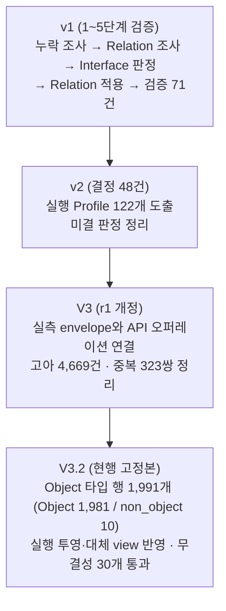

# 03. IM 모델과 오브젝트 도출 (IM Object Model V3.2)

**IM 오브젝트 모델(Information Map 기반 오브젝트 모델)**은 Information Map(정보 지도)에서 도출한 AEGI의 표준 오브젝트 모델로, 여러 SaaS의 서로 다른 객체·권한·신원·연동을 **Interface 9종**과 **Relation 17종(+ 의미 층)**의 닫힌 어휘로 표현한다.

---

## 1. 핵심 의미 계층과 정본 규격

AEGI는 **벤더가 준 사실(Object, Relation)**과 **엔진이 계산한 결론(Link, Effective Access)**을 저장소와 질의 수준에서 엄격히 분리한다.

| 층 | 역할 | 정본 문서 | 기계 판독 온톨로지 |
| --- | --- | --- | --- |
| **Interface 9종** | `Tenant`, `Principal`, `Credential`, `Resource`, `Policy`, `Assignment`, `Integration`, `Endpoint`, `Automation` — 객체에 붙는 다중 태그이자 계약 | [Interface_Spec_v3.md](../../framework/schema/specs/Interface_Spec_v3.md) | [interfaces.yaml](../../framework/schema/ontology/interfaces.yaml) |
| **Object** | 수집한 대상 하나가 한 행 (식별자, 타입, 인터페이스, 속성, 참조) | [Object_Schema_v4.1.md](../../framework/schema/specs/Object_Schema_v4.1.md) | [providers.yaml](../../framework/schema/ontology/providers.yaml) |
| **Relation 17종** | 대상 사이의 사실 하나가 한 행 (부여 16 + 구조 1, `stated`/`computed`/`flag` 근거 구분) | [Relation_Schema_v3.md](../../framework/schema/specs/Relation_Schema_v3.md) | [relation_types.yaml](../../framework/schema/ontology/relation_types.yaml) |
| **Relation Semantic Layer** | 기록 층(관계 17종) 위에 엔진이 읽는 정식 의미 층(사실 9종 + 능력 10종) | [Relation_Semantic_Layer_v1.md](../../framework/schema/specs/Relation_Semantic_Layer_v1.md) | [relation_semantics.yaml](../../framework/schema/ontology/relation_semantics.yaml) |
| **Link** | 서로 다른 SaaS 계정의 동일인·동일 자동화 판단 (Relation과 별개 저장소) | [Link_Schema_v3.md](../../framework/schema/specs/Link_Schema_v3.md) | [crosswalk.yaml](../../framework/schema/ontology/crosswalk.yaml) |
| **Effective Access** | "실제로 무엇을 할 수 있는가"를 합성 계산한 결론 (`via`, `cut` 포함) | [Effective_Access_Schema_v1.md](../../framework/schema/specs/Effective_Access_Schema_v1.md) | [access_rules.yaml](../../framework/schema/ontology/access_rules.yaml) |
| **Cut Action** | 위험 경로를 차단하기 위해 어느 SaaS의 어떤 설정/API를 끊어야 하는지 정의 | [Cut_Action_Schema_v1.md](../../framework/schema/specs/Cut_Action_Schema_v1.md) | [cut_actions.yaml](../../framework/schema/ontology/cut_actions.yaml) |

---

## 2. 오브젝트 모델 도출 및 진화 과정 (v1 → v2 → V3 → V3.2)

IM Object Model은 벤더 문서에서 뽑은 후보를 단계별 검증과 실측 대조를 거쳐 고정했다.



- 단계별 조사 기록: [im-model/README.md](../../framework/schema/im-model/README.md), [im-model/design/](../../framework/schema/im-model/design/)
- r1 개정 파이프라인(V3 생성 도구): [extraction/r1/README.md](../../framework/schema/im-model/extraction/r1/README.md)
- V3.2 고정본 상세: [model/v3.2/README.md](../../framework/schema/im-model/model/v3.2/README.md)
- 객체 타입 보안 관련성 시험: [relevance/README.md](../../framework/schema/im-model/relevance/README.md)

---

## 3. V3.2 고정본 무결성 검증

`framework/schema/im-model/model/v3.2/`의 40개 파일은 해시 기반으로 동결되어 있으며, 아래 명령으로 변조 여부를 즉시 검증할 수 있다.

```bash
npm run verify:freeze
```

정상일 경우 `"status": "intact", "problems": []`를 반환한다.
