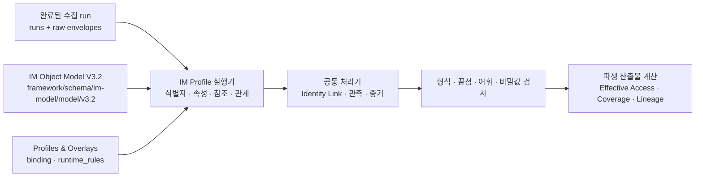

# 04. IM Profile 정규화와 Effective Access

**IM 모델**이 "무엇을 어떤 객체와 관계로 이해할 것인가"를 정한다면, **IM Profile**은 "수집된 실제 API 응답에서 그 객체와 관계를 어떻게 추출할 것인가"를 선언하는 실행 계약이다.

---

## 1. 단일 IM Profile 정규화 파이프라인

AEGI는 SaaS별로 제각각 손코딩한 정규화기를 두지 않고, **단일 IM Profile 실행기**가 IM V3.2 모델과 Profile/Overlay를 읽어 일관된 그래프를 생성한다.

- Profile 형식 규격: [Profile_Schema_v4.2.md](../../framework/schema/specs/Profile_Schema_v4.2.md)
- 단일 정규화 파이프라인 명세: [IM_PROFILE_PIPELINE.md](../../specs/IM_PROFILE_PIPELINE.md)
- 실행기 코드 위치: `runtime/engine/scripts/collect/profile-binding/`

---

## 2. 정규화 출력 데이터셋

정규화가 완료되면 아래 표준 파일 세트가 생성된다.

| 파일 | 역할 |
| --- | --- |
| `manifest.json` | 실행기 버전, IM V3.2 모델 위치, 원본 수집 run ID, 생성 시각 |
| `objects.json` | 정규화된 Object 행 목록 (9종 Interface 태그 포함) |
| `relations.json` | 설정·구조 기반 Relation 17종 (`stated`, `computed`, `flag`) |
| `links.json` | `crosswalk.yaml` 기반 Cross-SaaS 동일인·동일 자동화 연결 (`resolved`, `possibly_same` 등) |
| `observations.json`, `evidence_links.json` | 봇 호출·자격증명 사용·전송 관측과 근거 연결 |
| `effective_access.json` | 그룹 상속(`x_member_grant`), 자동화 실행 신원 상속(`runs_as_inherits`) 등을 합성 계산한 실질 접근 결과 (`via`, `cut` 포함) |
| `coverage.json` | 지정된 run의 API 호출 완결성 (수집 실패를 권한 부재로 오판하지 않기 위한 입력) |
| `lineage_events.json` | OpenLineage 스키마 검사를 통과한 데이터 계보 기록 ([AEGI_LINEAGE_V1.md](../../specs/AEGI_LINEAGE_V1.md)) |
| `runner-report.json`, `verify.json` | 추출 건수, 미해결 참조, 미사용 페이지, 검증 결과 요약 |

---

## 3. 사실과 추론의 분리 원칙

- **Relation**은 벤더 API가 돌려준 설정 사실이다.
- **Link**와 **Effective Access**는 여러 사실을 조합해 계산한 결론이다.
- **EA 행이 없다고 해서 "접근 불가"를 단정하지 않는다.** `coverage.json`과 `undecomposed` 필드를 함께 검토해 미확인 영역을 투명하게 드러낸다.
