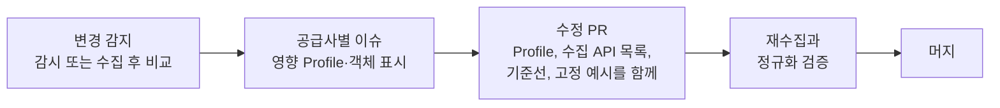

# 06. SaaS API 변경 감시

AEGI의 수집 API 목록과 IM Profile은 특정 시점의 벤더 공식 명세를 기준으로 만든다. 벤더 API는 계속 바뀌므로 그 기준과 현재 API가 어긋나는 순간을 따로 잡아야 한다. API 변경 감시는 **벤더 쪽 변경을 먼저 알아채는 감시**와 **수집할 때마다 실제 응답을 직전 수집과 비교하는 검사** 두 층으로 이 어긋남을 찾는다.

## 1. 왜 필요한가

정규화는 Profile에 선언한 필드를 경로로 꺼내기만 한다. 그래서 API가 바뀌어도 대부분 오류가 나지 않고 조용히 결과가 비거나 틀어진다.

| 벤더 쪽 변경 | 수집 결과에 남는 모습 | 판정에 미치는 영향 |
| --- | --- | --- |
| operation 삭제, 경로 변경 | `404`, `401`, 「조직에 없음」 | 해당 객체와 관계가 통째로 빠짐 |
| 쿼리 인자 이름 변경 | `404` 또는 빈 목록 | 위와 같음 |
| 응답 필드 삭제, 이름 변경 | 오류 없이 빈 값 | 관계가 끊기거나 속성 기반 판정이 빠짐 |
| 응답 필드 타입 변경 | 바뀐 타입 그대로 저장 | 비교, 조인 규칙이 맞지 않음 |
| 고정 API 버전의 노후화 | 새 객체가 목록에 보이지 않음 | 수집 대상에서 조용히 제외 |

수집 결과만 봐서는 원인이 권한 부족인지, 테넌트 설정인지, 벤더 API 변경인지 구별되지 않는다. 실제로 기준 명세와 한 달 뒤 같은 주소의 최신 명세를 비교했을 때 아래 같은 변경이 손 비교로만 드러났다.

- Okta: 공개 스펙에서 Cross App Access 연결 목록 operation이 빠지고, 호출은 `401`을 돌려줬다.
- GitHub: agent automations 목록 API에서 쿼리 인자 `owner_type`이 `type`으로 바뀌고, Profile이 쓰던 응답 필드 2개가 빠졌다. 호출은 `404`를 돌려줬다.
- Salesforce: 수집은 `apiVersion` 61.0에 고정돼 있었고, 그 사이 최신 버전은 68.0이 됐다. 그 결과 승인한 객체 일부가 `describeGlobal`에 보이지 않아 수집에서 빠졌다.

## 2. 기준점 원칙

- **기준은 「최신 문서」가 아니라 「우리가 맞춰 둔 판」이다.** [벤더 자료 출처 목록](../../framework/schema/im-model/extraction/sources_2026-10-13.md)에 기록한 주소, 해시, 수집 시각, 버전이 기준점이다.
- **기준선은 원본 명세 대신 「우리가 부르는 operation의 표면」만 담는다.** 인자, 필수 여부, 응답 필드와 타입, deprecated 표시만 뽑은 작은 JSON이다. 원본 명세는 보관소에 두고 저장소에는 표면만 넣는다. 누구나 같은 기준으로 비교할 수 있게 하기 위해서다.
- **기준점은 Profile과 수집 API 목록을 고치는 PR 안에서만 함께 올린다.** 기준점만 따로 올리면 「고치지 않았는데 기준만 최신」인 상태가 되어 다음 비교에서 변경이 보이지 않는다. 감시 실행이 기준선을 자동으로 덮어쓰지도 않는다.

## 3. 벤더 쪽 변경 감시

출처마다 가장 빨리, 가장 정확하게 바뀐 것을 알 수 있는 방법을 고른다. 아래 표는 빠른 순서다.

| 방법 | 무엇을 보나 | 대상 예 | 주기 |
| --- | --- | --- | --- |
| **API 자체** (`live`) | 운영 API가 직접 알려 주는 버전과 경고 | Salesforce 지원 버전 목록, 수집 응답의 헤더 `Deprecation`·`Sunset`과 Slack `warnings` | 하루 1번, 헤더는 수집 때 |
| **공식 스펙 저장소** (`repo`) | 벤더가 공개 저장소에 올리는 명세의 최신 커밋 | `github/rest-api-description`, `okta/okta-management-openapi-spec` | 하루 1번 |
| **스펙 주소 재수신** (`spec_url`) | 저장소가 없는 명세 파일의 해시 | GWS Discovery 문서(`revision`), Atlassian OpenAPI, Okta AI·IGA 명세, GitHub GraphQL 스키마 | 주 1번 |
| **변경 공지** (`changelog`) | 벤더 changelog, RSS의 새 글 | GitHub, Slack, Google Workspace 변경 공지, Okta 개발자 블로그 | 주 1번 |
| **문서 페이지 비교** (`doc_page`) | 기계 판독 명세가 없는 메서드 문서 | Slack 메서드 문서 | 주 1번 |
| **미리보기 테넌트** (`preview`) | 운영보다 먼저 배포되는 릴리스 | Okta Preview org, Salesforce 미리보기 샌드박스 | 계획 단계 |

해시나 커밋이 바뀌었을 때만 새 명세를 받아, 우리가 쓰는 operation의 표면만 기준선과 비교한다. 비교 대상은 operation 삭제, 메서드·경로 변경, 인자 이름과 필수 여부, 응답 필드의 삭제·타입 변경·deprecated 표시다. 정책이나 rate limit 변경처럼 명세에 나오지 않는 변경은 변경 공지로만 잡는다.

고정 버전(Salesforce `apiVersion`, GitHub `X-GitHub-Api-Version` 등)은 감시 설정 한 곳에 모아 두고, 공급사가 밝힌 지원 종료일과 최신 사용 가능 버전을 함께 비교한다.

## 4. 수집할 때마다 실제 응답 비교

명세만 봐서는 테넌트 권한 변화나 문서에 적히지 않은 변경을 잡지 못한다. 그래서 수집 run이 끝나면 저장된 원본과 정규화 결과를 직전 정상 run과 비교한다. 수집 중에는 추가 호출을 하지 않고, 이미 받은 응답만 읽는다.

- **호출 상태 악화**: `full`·`partial`이던 호출이 `4xx`나 `skipped`가 된 경우를 찾는다.
  - `401`, `403`: 권한이나 테넌트 문제로 분류한다.
  - `404`, `410`: API 변경을 의심하고 해당 operation의 명세를 기준선과 바로 다시 비교한다. 명세가 그대로면 「스펙은 그대로, 권한·테넌트 확인」으로 안내한다.
- **응답 모양 변화**: 응답 필드가 빠지거나 타입이 바뀐 경우를 찾는다.
- **Profile 필드 채움 비율**: 정규화는 필드가 사라져도 오류를 내지 않으므로, Profile별로 각 필드에 값이 있는 객체의 비율을 직전 run과 비교한다.
  - 직전에 50% 이상 채워졌는데 이번에 절반 이하로 떨어지면 경고, 0%가 되면 악화로 본다. 객체가 3개 이상일 때만 판단한다.
  - 값 타입이 직전과 하나도 겹치지 않으면 깨짐으로 본다. 개인정보 가림 처리한 값은 비교에서 뺀다.
  - 명세의 「필수」 표시를 절대 기준으로 쓰지 않는 이유는 오탐 때문이다. 명세에는 필수인데 원래 응답에 없는 필드가 많다. 그래서 같은 테넌트의 직전 run과 비교한다.

## 5. 결과 분류

| 심각도 | 기준 | 처리 |
| --- | --- | --- |
| **깨짐** (`break`) | operation 삭제, 메서드·경로 변경, 필수 인자 추가, 우리가 쓰는 응답 필드의 삭제·타입 변경, 호출 `404`·`410`, 고정 버전 지원 종료 | 공급사별 이슈 |
| **곧 깨짐** (`soon`) | operation·필드 deprecated, sunset 표시, 고정 버전이 최신보다 크게 뒤처짐, 지원 종료 6개월 이내 | 공급사별 이슈 |
| **추가** (`added`) | 선택 인자나 응답 필드 추가 | 보안에 쓸 만한 새 필드 후보 목록 |
| **정보** (`info`) | 명세 버전 변경, 새 API 버전 출시, 일반 변경 공지 | 보고서에만 기록 |

이슈는 출처마다 하나를 두고 새 항목만 댓글로 더한다. 같은 변경을 매일 새 이슈로 다시 알리지 않기 위해서다.

## 6. 영향 찾기

변경 하나가 어디까지 영향을 주는지 이슈에 함께 적는다.

```text
operation → Profile 필드 → IM 객체 타입 → Interface
```

수집 API 목록의 `operation_id`와 Profile의 필드 경로를 이어 표로 만든다. 컴플라이언스 판정은 객체 타입 목록이 아니라 Interface·관계 패턴과 설명문으로 정의돼 있어 기계적으로 잇지 않고, 사람이 Interface 단위에서 확인한다.

## 7. 버전 올리기와 회귀 시험

- **그림자 수집**: 새 API 버전이나 설정 값을 시험할 때는 설정 사본에 새 값을 덮어써 한 SaaS만 따로 수집하고, 정규화 결과를 지금 버전과 비교한다. 객체·필드 차이를 사람이 보고 승인하면 고정 버전을 올린다.
- **고정 예시**: operation마다 실제 응답을 비식별 처리한 예시 레코드를 저장소에 두고, 이 예시로 정규화를 돌린 기대 결과(Profile별 객체 수, 값이 있는 필드)를 함께 둔다. API가 바뀌어 예시를 새로 만들면 기대 결과의 diff가 곧 Profile 영향이다. 기대 결과는 Profile을 고치는 PR 안에서만 갱신한다.

## 8. 고치는 흐름



## 9. 실행

AEGI 엔진의 `scripts/collect/apiWatch/`에 구현돼 있다. 감시는 서버 cron으로 하루 1번 돌리고, 수집 직후 비교는 수집이 도는 곳에서 바로 실행한다.

| 명령 | 하는 일 |
| --- | --- |
| `npm run api-watch -- check [--open-issues]` | 공식 스펙, 변경 공지, API 버전을 기준선과 비교해 보고서를 만들고, 필요하면 이슈를 연다 |
| `npm run api-watch -- after-collect --current <run_id>` | 수집 run을 직전 run과 비교하고, `404`·`410` 호출은 명세와 대조한다 |
| `npm run api-watch -- versions` | 고정 버전, 지원 종료일, 최신 사용 가능 버전을 표로 보여 준다 |
| `npm run api-watch -- baseline --source <id> --file <명세>` | 명세 파일에서 기준선 표면을 만든다 |
| `npm run api-watch -- fixtures --run <run_id>` | 수집 run에서 비식별 고정 예시와 기대 결과를 만든다 |
| `npm run collect:diff` | 두 수집 run의 응답 모양과 Profile 필드 채움 비율을 비교한다 |
| `npm run collect:shadow -- --provider <name> --set <키>=<값>` | 설정 하나를 바꾼 그림자 수집과 비교를 실행한다 |

관련 문서:
- [벤더 명세와 테넌트 정보 수집](01-metadata-collection.md)
- [IM Profile 정규화와 Effective Access](04-profile-and-normalization.md)
- [새 SaaS 추가](../03-enterprise-adoption/adding-new-saas.md)
