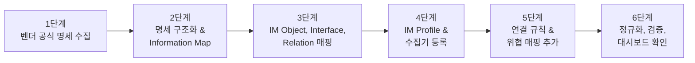

# 새 SaaS 추가 플레이북

지원 SaaS 외에 **Workday나 기업 내부 SaaS**도 같은 방법론과 규격으로 추가한다. 아래 6단계를 따르면 엔진 코어를 고치지 않고 새 SaaS를 Cross-SaaS 그래프와 위협 판정에 넣는다.

## 전체 확장 흐름



## 1단계 벤더 공식 API와 로그 명세 확보

대상 SaaS의 공식 문서를 확보하세요.
- OpenAPI(YAML/JSON), GraphQL SDL, Discovery 문서 또는 공식 REST API 명세
- 감사 로그 이벤트 유형 목록
- 권한(OAuth Scope / RBAC Role) 문서

참고: `framework/schema/im-model/extraction/ir2/norm_m365.py`가 Microsoft 365(Microsoft Graph)를 대상으로 작성된 최신 확장 예제다.

## 2단계 명세 구조화와 Information Map 도출

1. `framework/schema/im-model/extraction/ir2/`에 `norm_<provider>.py`를 작성해 벤더 명세를 공통 형식(`operation`, `param`, `response shape`)으로 변환하세요.
2. `ir2/map3.py` 또는 `extract.py` + `info_map.py`를 실행해 후보 오브젝트, ID 공간, 정보 지도를 생성하세요.
3. 구조만으로 모호한 항목은 `lexicons/<provider>.yaml`에 판단 이유와 함께 적으세요.

상세 설명: [02. Information Map 도출](../02-methodology/02-ir-and-information-map.md)

## 3단계 IM Object, Interface, Relation 매핑

도출된 후보를 AEGI의 닫힌 어휘에 매핑하세요.
1. **Interface 9종** 부여 (`framework/schema/ontology/interfaces.yaml`): `Tenant`, `Principal`, `Credential`, `Resource`, `Policy`, `Assignment`, `Integration`, `Endpoint`, `Automation`
2. **Relation 17종** 연결 (`framework/schema/ontology/relation_types.yaml`): 소속(`member_of`), 권한 부여(`has_role_on`), 실행 신원(`runs_as`) 등
3. **Cross-SaaS 신원 매핑** (`framework/schema/ontology/crosswalk.yaml`): 이메일, 외부 ID, 연합 신원 키 정의

참고 규격: [Object_Schema_v4.1.md](../../framework/schema/specs/Object_Schema_v4.1.md), [Relation_Schema_v3.md](../../framework/schema/specs/Relation_Schema_v3.md), [Link_Schema_v3.md](../../framework/schema/specs/Link_Schema_v3.md)

## 4단계 IM Profile 작성과 읽기 전용 수집기 연결

1. [Profile_Schema_v4.2.md](../../framework/schema/specs/Profile_Schema_v4.2.md) 형식에 따라 `runtime/vendor/engine/scripts/collect/profile-binding/overlays/<provider>/`에 Profile/Overlay를 추가하세요.
2. 읽기 전용 API 호출 정의를 수집기(`runtime/vendor/engine/scripts/collect/`)에 등록하세요.
3. 완료된 수집 run에 대해 정규화 검증을 실행하세요.
   ```bash
   # 먼저 런타임 패키지를 설치한다: npm run runtime:install
   # 정규화 결과 및 형식/EA/OpenLineage 스키마 무결성 검사 (파일 미생성 dry-run)
   node runtime/vendor/engine/scripts/collect/profile-binding/runner/normalize.mjs --raw <수집폴더> --run <run-id> --out <출력폴더> --check
   ```

## 5단계 Cross-SaaS 연결 규칙과 위협 매핑 추가

1. **연결 확인 규칙**: `framework/connection-rules/rules/<provider>-<other>.yaml` 형식으로 다른 SaaS, 외부 서버와의 연동 확인 규칙(`identify`, `points_to`, `tier`, `activity`, `sources`)을 추가하세요. 형식은 [규칙 형식 안내](../../framework/connection-rules/docs/how-to-read.md)에 있다.
2. **위협 매핑**: `framework/threat-mapping/<provider>/` 폴더에 `README.md`, `threats.csv`, `objects.csv`를 표준 열 규격에 맞춰 작성하세요. 열 규격은 [작성 규격](../../framework/threat-mapping/README.md)에 있다.

## 6단계 통합 검증

1. `npm run verify`로 안전성 검사, 문서 링크 검사, IM 모델 무결성을 확인하세요.
2. `runtime/`에서 새 SaaS의 읽기 전용 자격증명으로 수집, 정규화, 판정을 차례로 실행하세요. 대시보드 **Cross-SaaS Graph**, **Threat**, **Compliance**에서 객체, 연결, 위협이 정상 표시되는지 확인하세요.
