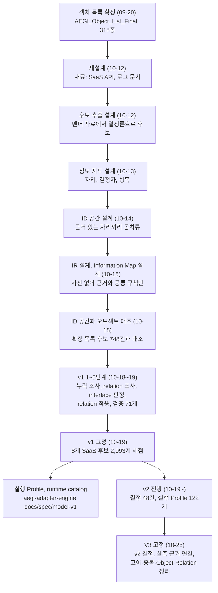

# IM 모델 (Identity and Integration Model)

운영 연결 보완(2026-10-28): Profile 단일 정규화는 main에 적용됐고 approved operation 레지스트리도 수집기에 연결됐다. 아래 도출 기록과 고정 모델 수치는 연구 시점의 근거다. 현재 사용 현황은 [현재 구조](../../docs/architecture/current-state.md)와 엔진 IM_PROFILE_PIPELINE/TOTAL_COLLECTOR를 따른다.

IM 모델은 SaaS의 객체, 권한, 신원, 연동을 인터페이스 9종과 관계 17종으로 표현하는 AEGI의 오브젝트 모델이다. 2026-10-19에 v1을 고정했고(옛 aegi-dashboard PR #117), v2 결정과 실측 근거 연결(r1 개정)을 반영해 2026-10-25에 V3를 고정했다([model/v3](model/v3/README.md)). Profile 정규화 중 발견한 누락을 반영한 V3.2도 고정했으며([model/v3.2](model/v3.2/README.md)), 이 폴더에는 모델이 **어떻게 도출됐는지**(설계와 조사), **판별 기록**(v1, v2 문서), **도출 도구**(연구 코드)가 있다.

상태: 구현 설명과 과거 기록. 2026-10-23에 옛 aegi-dashboard `2b1e748`, aegi-adapter-engine `c6a6f7a`에서 옮겼다. 관련 이슈: [#54](https://github.com/AEGI-Inc/aegi-knowledge/issues/54), aegi-adapter-engine #85.

V3.2 고정 뒤의 기록: 객체 타입 보안 관련성 시험 v1은 [relevance](relevance/README.md)에, 사람이 정한 같은 실체 판정은 [identity-decisions-after-v3.2](identity-decisions-after-v3.2.md)에 있다(2026-11-01).

규격의 정본은 이 폴더가 아니다. 필드와 어휘는 [specs](../specs/)와 [ontology](../ontology/)가 정본이고, 여기 있는 문서는 그 규격에 이르기까지의 근거와 기록이다.

## 구성 층과 정본 위치

| 층 | 뜻 | 정본 | 운영에서 쓰는 곳 |
| --- | --- | --- | --- |
| 인터페이스 9종 | Tenant, Principal, Credential, Resource, Policy, Assignment, Integration, Endpoint, Automation | [Interface_Spec_v3](../specs/Interface_Spec_v3.md), `ontology/interfaces.yaml` | 정규화가 객체마다 태그를 붙이고, 판정과 화면이 태그를 읽는다 |
| 관계 17종 | 닫힌 관계 어휘와 근거(stated, computed, flag) | [Relation_Schema_v3](../specs/Relation_Schema_v3.md), `ontology/` | 정규화, 판정, 화면 |
| Link | SaaS 계정의 동일인 판단과 단계 | [Link_Schema_v3](../specs/Link_Schema_v3.md), `ontology/crosswalk.yaml` | 정규화의 SaaS 간 연결 |
| Object, Profile | 객체 계약, SaaS별 수집 Profile 형식 | [Object_Schema_v4.1](../specs/Object_Schema_v4.1.md), [Profile_Schema_v4.2](../specs/Profile_Schema_v4.2.md) | 객체 형식. Profile 정규화와 검토 operation의 수집 레지스트리가 연결된다. 타입/operation마다 실행 승인과 실제 수집 결과는 별도다 |
| 객체 카탈로그 | SaaS별 객체 종류 318개와 인터페이스 | aegi-adapter-engine `src/objectCatalog.ts` (원본 `AEGI_Object_List_Final_2026-09-20.xlsx`) | 수집 범위 사후 비교(`collect:coverage`), 정규화 대응표에 없는 타입 조회 |
| ID 공간, Information Map | 같은 대상을 가리키는 식별자 자리의 동치류와 그 지도 | 이 폴더 [design](design/) | 운영 미사용. 연구 단계에서 멈춤 |

현재 운영 연결(2026-10-28): 인터페이스는 IM Profile과 보정/판정 선언을 단일 실행기에서 읽어 붙인다. 삭제된 normalize/dataset.ts의 CATALOG 표가 현재 태그 생성 주체가 아니다. 수집은 providers 호출 뒤 승인된 IM operation 레지스트리를 실행한다.

## 도출 과정

## 폴더 안내

### [design/](design/): 설계와 조사 (과거 기록)

옛 aegi-dashboard 저장소 루트에 있던 문서다. 저장소 분리(2026-10-21) 때 새 저장소로 옮겨지지 않았던 것을 가져왔다.

| 문서 | 내용 |
| --- | --- |
| [오브젝트 모델 재설계](design/오브젝트%20모델%20재설계.md) | 오브젝트를 뽑는 재료와 기준을 다시 정한 메모 |
| [오브젝트 후보 추출 설계](design/오브젝트%20후보%20추출%20설계.md) | 벤더 자료에서 후보를 뽑는 절차(초안) |
| [정보 지도 설계](design/정보%20지도%20설계.md) | 자리, 결정자, 항목으로 정보 지도를 만드는 초안 |
| [ID 공간 설계](design/ID%20공간%20설계.md) | 스키마 근거로 ID 공간을 정하는 절차와 공리 |
| [IR 설계](design/IR%20설계.md) | Information Map의 재료가 되는 중간 표현 |
| [Information Map 설계](design/Information%20Map%20설계.md) | 사람이 쓴 사전을 판정에서 뺀 지도 설계 |
| [ID 공간 오브젝트 대조](design/ID%20공간%20오브젝트%20대조.md) | ID 공간을 확정 오브젝트 목록과 맞춘 결과 |
| [v1 1단계 누락 조사](design/오브젝트%20모델%20v1%201단계%20누락%20조사.md) ~ [5단계 검증](design/오브젝트%20모델%20v1%205단계%20검증.md) | v1 단계별 조사와 결과 |
| [v1 진행 현황](design/오브젝트%20모델%20v1%20진행%20현황.md) | v1 전체 수치와 고정 기록 |
| [1단계 판단표](design/1단계%20판단표.html) | 사람 판단을 받은 표(HTML) |
| [research/](design/research/) | Cartography 온톨로지 비교, 복잡계 모델링 조사 |

### [model/](model/): v1, v2 판별 기록

aegi-adapter-engine `docs/spec`에서 옮겼다.

| 문서 | 내용 |
| --- | --- |
| [AEGI_OBJECT_MODEL_V1](model/AEGI_OBJECT_MODEL_V1.md) | IM 모델 v1 안내: 무엇을 고정했나, SaaS별 준비 상태, 새 SaaS Profile 추가 절차 |
| [AEGI_OBJECT_MODEL_V1_RUNTIME](model/AEGI_OBJECT_MODEL_V1_RUNTIME.md) | v1 수집 Profile의 실제 수집 적용과 실행 명령 |
| [AEGI_OBJECT_MODEL_V2_HANDOFF](model/AEGI_OBJECT_MODEL_V2_HANDOFF.md), [V2_PROGRESS](model/AEGI_OBJECT_MODEL_V2_PROGRESS.md) | v2 결정과 남은 검토 항목 |
| [AEGI_SCHEMA_REEXTRACT_VS_ADAPTER](model/AEGI_SCHEMA_REEXTRACT_VS_ADAPTER_2026-09-28.md) | 규격 기준 재추출과 정규화 어댑터의 행 단위 비교(09-28) |
| [v3/](model/v3/README.md) | IM Object Model V3 고정본(2026-10-25): Object 타입 1,980개, binding 13건, typed reference 5,293개 처리, 결정 R1-D01~D14. `node schema/im-model/model/v3/verify-freeze.mjs`로 고정 상태를 확인한다 |
| [v3.2/](model/v3.2/README.md) | IM Object Model V3.2 고정본(2026-10-25): Slack 대체 view 관측 및 runtime catalog 실행 판정 반영. `node schema/im-model/model/v3.2/verify-freeze.mjs`로 고정 상태를 확인한다 |

### [extraction/](extraction/): 도출 도구 (Python 연구 코드)

aegi-adapter-engine `candidate-extraction/`에서 옮겼다. 사용법은 [extraction/README.md](extraction/README.md)와 [ir2/README.md](extraction/ir2/README.md)에 있다. V3를 만든 Node.js 개정 도구는 [extraction/r1/](extraction/r1/README.md)에 있다. 결정 정본은 `ir2/v2/relation_decisions_v2.json`, v1 고정 기록은 `ir2/model_v1_freeze.json`이다.

옮기지 않은 것:

- SaaS API를 부르는 코드: 테넌트 실측 수집 `ir2/collect/tenant/`, Cartography 소스 사본 `ir2/collect/carto/snapshot/`. 이 저장소에는 SaaS API 호출 코드를 두지 않는다. aegi-adapter-engine `candidate-extraction/ir2/collect/`에 남아 있다. `ir2/collect/carto/carto_nodes.py`는 그 사본을 읽으므로 다시 돌릴 때 경로를 맞춘다.
- git에 넣지 않은 산출물: `out/`, `ir2/out2/`, `ir2/cache/`. `out2`에는 테넌트 실측 값이 섞여 있어 넣지 않는다. 문서 안에서 이 산출물을 가리키던 링크는 경로만 글씨로 남겼다.
- 운영 코드가 입력으로 읽는 파일: aegi-adapter-engine `docs/spec/model-v1/*.json`(model-v1 투영), `docs/spec/profiles/*.yaml`(세팅, Profile 검사).

## 옮긴 문서의 링크

옮긴 문서의 상대 링크는 다음처럼 바꿨다. 본문은 고치지 않았다.

- 함께 옮긴 파일을 가리키면 새 상대 경로
- 원 저장소에만 있는 파일이면 그 저장소의 커밋 고정 링크(옛 aegi-dashboard `2b1e748`, aegi-adapter-engine `c6a6f7a`)
- 어디에도 없는 파일(git 제외 산출물)이면 링크를 풀고 경로만 남김

본문의 코드 경로(`candidate-extraction/…`, `scripts/…`)는 원 저장소 기준이다. `candidate-extraction/`은 이 폴더의 `extraction/`으로 읽는다.
