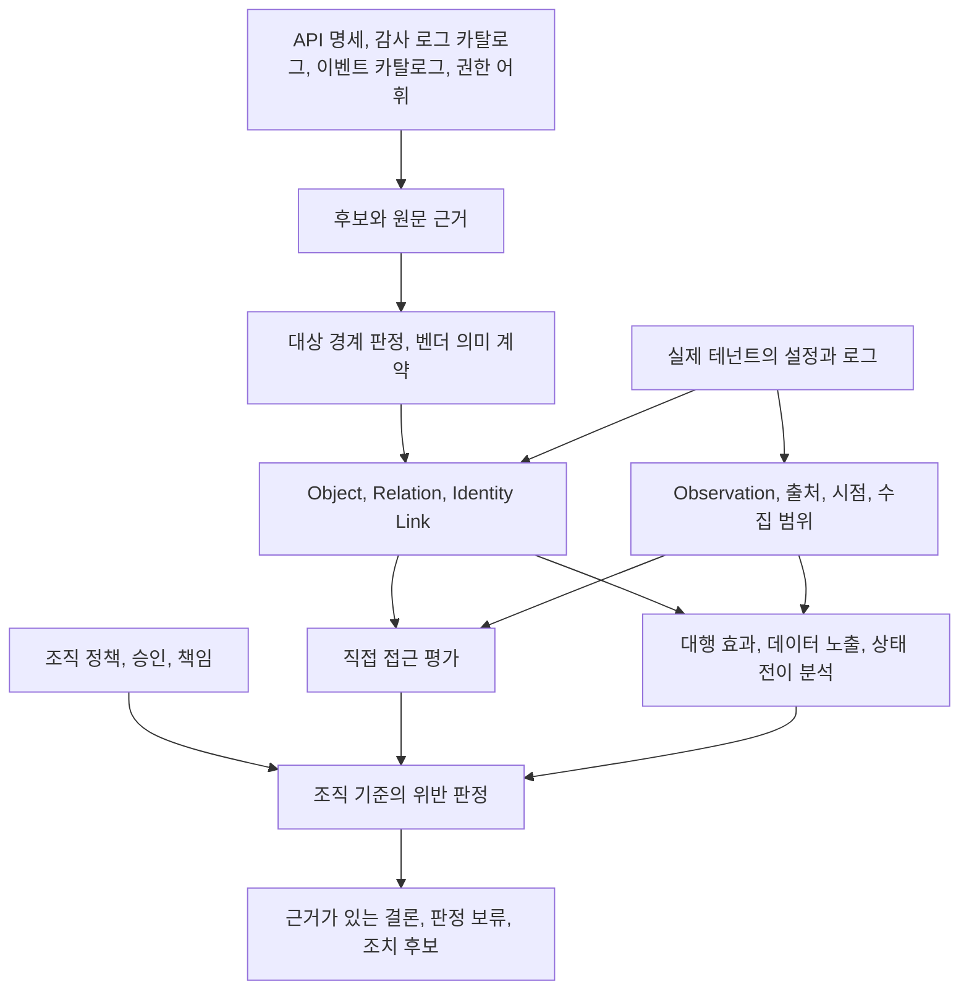

# 기업 SaaS 복잡계 모델링 조사와 AEGI 적용안

기업 SaaS의 보안 동작을 표현하려면 객체와 관계에 더해 권한 조건, 상태를 바꾸는 동작, 데이터 이동, 시간과 관측 공백을 함께 모델링해야 한다. AEGI에는 온톨로지를 공통 언어로 두고, 권한 평가와 상태 전이 모델을 결합하는 접근을 제안한다.

조사일: 2026-10-13, KST. 공식 문서, 표준, 원 논문을 우선 조사했다. 아래에서 외부 자료의 설명과 AEGI 적용 제안을 구분한다. 적용안은 채택된 스키마가 아니다.

핵심 판단은 세 가지다.

1. 모든 SaaS 객체를 열거하는 것과 시스템의 보안 동작을 충분히 표현하는 것은 다른 문제다. 객체 목록이 넓어도 권한 상승, 대행 실행, 데이터 복사와 회수 지연을 설명하지 못하면 중요한 동작이 빠진다.
2. 후보는 자료에서 넓게 찾고, 객체의 경계는 식별성, 수명, 독립된 보안 효과로 정한다. Interface는 그렇게 구분한 대상이 수행하는 역할과 계약을 붙이는 수단으로 사용한다.
3. 완전성은 범위를 정해 검증해야 한다. 대상 제품과 버전, 수집 권한, 시점, 지원 동작과 질문을 선언하고, 그 범위에서 빠진 근거를 식별해야 한다.

**1. ‘완전하게 표현한다’는 목표를 어떻게 정할 것인가**

시스템 전체를 오차 없이 복제하는 모델은 현실적인 목표가 아니다. TLA+의 설계자 Leslie Lamport도 모델을 특정 목적을 위해 시스템의 일부 측면을 기술하는 것으로 설명한다. 상태 전이 모델의 검증 역시 모델에 적힌 동작과 조건에 대한 검증이다. 실제 SaaS에 있는 모든 동작을 알아냈다는 보증과 다르다. [TLA+의 모델과 검증 설명](https://lamport.azurewebsites.net/tla/high-level-view.html)

AEGI에서는 다음처럼 목표를 좁혀 명시하는 것이 유용하다.

> 선언한 SaaS 기능 범위에서, 누가 어떤 조건으로 어떤 자원에 직접 접근하거나 다른 실행 주체를 통해 효과를 일으킬 수 있는지 설명한다. 설정 변경으로 새로 얻을 수 있는 접근, 데이터가 복사된 뒤의 노출, 권한 회수 뒤의 잔여 접근을 구분한다. 결론을 낼 수 없는 구간은 필요한 근거와 함께 반환한다.

이것은 기업의 모든 업무, 직원의 의도, 자동화 코드의 임의 동작까지 포함하는 모델과는 범위가 다르다. 업무 승인과 목적 제한까지 평가하려면 조직의 정책과 책임 정보도 별도로 받아야 한다.

완전성은 적어도 다음 네 가지로 나눠야 한다.

| 구분 | 확인할 내용 | 통과했다고 말할 수 있는 범위 |
|---|---|---|
| 자료 범위 | 제품, 버전, API와 이벤트 카탈로그를 빠짐없이 검토했는가 | 선언한 자료에서 후보를 추출했다 |
| 의미 범위 | 인증, 권한, 위임, 실행, 데이터 이동과 변경 동작을 표현하는가 | 선언한 보안 메커니즘을 모델링했다 |
| 관측 범위 | 해당 테넌트에서 필요한 목록과 기록을 실제로 읽었는가 | 선언한 시점과 권한에서 판정 근거를 확보했다 |
| 질문 범위 | 직접 접근, 간접 효과, 변경 후 접근과 회수를 대조 검증했는가 | 해당 질문 집합에서 결론을 검증했다 |

객체 타입 수나 관계 수 하나로 이 네 가지를 대신할 수 없다. 분모를 알 수 없는 ‘전체 SaaS의 몇 퍼센트’는 주장하지 않는 편이 정확하다.

**2. 조사한 접근은 각각 무엇을 해결하는가**

| 접근 | 모델링 단위와 강점 | AEGI에 가져올 것과 한계 |
|---|---|---|
| Cartography | 벤더 객체, 관계, 공통 의미 라벨과 일부 통합 객체 | 수집과 의미 정규화의 분리. 수집한 그래프가 모든 보안 동작을 표현한다고 가정하지 않는다 |
| Palantir Ontology | 객체, 속성, 링크, 인터페이스, 액션과 함수 | 업무 개념과 동작을 함께 정의. 플랫폼의 운영 모델을 SaaS 권한 의미와 혼동하지 않는다 |
| OntoClean와 질문 기반 온톨로지 설계 | 동일성, 타입과 역할의 구분, 답해야 할 질문 | 계정과 사람, 객체와 관리자 역할을 구분. 알려진 질문만으로 후보 범위를 제한하지 않는다 |
| Zanzibar, ABAC와 Cedar | 관계와 속성, 동작, 대상, 요청 조건에 따른 권한 평가 | 권한을 단순 연결성으로 계산하지 않는다. 실제 벤더의 평가 순서를 보존한다 |
| MulVAL 계열 논리 추론 | 사실과 전제 조건에서 파생되는 보안 효과 | 여러 조건을 모두 만족해야 하는 간접 접근. 규칙에 없는 동작은 설명하지 못한다 |
| 상태 전이와 TLA+ | 현재 상태, 허용 동작, 다음 상태와 불변조건 | 권한 상승과 회수 순서, 세션 잔존 검증. 전체 기업 상태를 한 번에 탐색하면 규모가 커진다 |
| 객체 중심 프로세스 마이닝, OCEL | 여러 객체가 참여하는 이벤트, 시간에 따른 속성 변화 | 설치, 동의, 실행, 전달의 흐름 연결. 이벤트 공존이 곧 인과관계라는 뜻은 아니다 |
| STAMP와 STPA | 제어 주체, 제어 동작, 피드백, 위험 상태와 제약 | 정상 기능의 조합에서 생기는 통제 실패를 검토. API에서 기업의 정책 의도가 자동으로 나오지는 않는다 |

이 비교는 각 접근을 AEGI 목적에 맞춰 해석한 것이다. 각 방법을 모두 제품에 구현해야 한다는 뜻은 아니다. 구체적인 사실과 근거는 아래에 적는다.

**Cartography와 Palantir: 넓은 수집과 의미 설계는 둘 다 필요하다**

현재 Cartography도 온톨로지 모듈을 제공한다. 벤더 노드에 `UserAccount`, `ServiceAccount` 같은 의미 라벨을 붙이고 일부 통합 노드를 만든다. 사용자와 장치의 기준 출처를 지정해 다른 모듈이 임의로 통합 객체를 만들지 못하게 할 수도 있다. 따라서 Cartography를 단순 API 객체 목록으로만 보는 것은 정확하지 않다. [온톨로지 설명](https://docs.cartography.dev/modules/ontology/index.html), [출처 설정](https://docs.cartography.dev/modules/ontology/config.html), [공통 스키마](https://docs.cartography.dev/modules/ontology/schema.html)

Cartography의 GCP 권한 매핑 문서는 모든 권한을 계산하고 저장하기 어렵기 때문에 지정한 권한 관계만 계산한다고 명시한다. 이것은 넓은 자산 그래프와 권한 의미의 포괄성이 별개임을 보여주는 구체적인 사례다. 이 제한을 모든 Cartography 모듈의 동작으로 일반화하지는 않는다. [GCP 권한 매핑](https://docs.cartography.dev/modules/gcp/permission-mapping.html)

Palantir는 Ontology를 객체와 링크뿐 아니라 액션과 함수까지 포함하는 운영 계층으로 설명한다. 설계 지침은 API 응답이나 테이블을 그대로 객체로 복제하지 말고, 실제 의미가 있는 대상을 찾도록 권한다. 관측과 관측 대상의 동일성을 분리하고, 공통 기능은 인터페이스로 추상화하며, 실제 질문으로 모델을 검증한다. [Ontology 개요](https://www.palantir.com/docs/foundry/ontology/overview), [설계 지침](https://www.palantir.com/docs/foundry/ontology/ontology-best-practices)

AEGI 적용 제안: 자료를 넓게 조사하는 방식은 유지한다. 다만 명세의 `object`나 응답 스키마를 곧바로 보안 객체로 채택하지 않는다. 벤더의 표현과 공통 보안 의미를 분리하고, 그 사이의 변환 계약을 검증한다. 대시보드의 처리 액션과 모델 속 SaaS의 동작도 구분해야 한다. ‘예외 처리’는 AEGI 업무 동작이고, ‘토큰 발급’은 관측 대상 시스템의 상태를 바꾸는 동작이다.

**OntoClean와 Competency Questions: 무엇이 같은 대상인지 먼저 정한다**

OntoClean은 분류 체계의 상하위 관계를 동일성, 본질적 성질, 통일성과 의존성으로 검토하는 방법이다. AEGI에 적용하면 ‘사람’과 ‘관리자 역할’을 같은 종류의 타입으로 취급하지 않는 기준이 된다. 관리 권한이 사라져도 계정의 동일성은 유지되므로, 관리자 여부는 보통 역할 부여나 상태로 표현하는 편이 적절하다. 이것은 원 방법을 SaaS에 적용한 해석이다. [Guarino와 Welty의 원 논문](https://doi.org/10.1145/503124.503150), [동일성과 분류에 대한 논문](https://www.sciencedirect.com/science/article/pii/S0169023X01000301)

Competency Questions는 온톨로지가 답해야 하는 자연어 질문으로 범위를 정하고 검증하는 접근이다. ‘누가 문서를 읽을 수 있는가’, ‘누가 자동화 실행 결과를 외부로 보낼 수 있는가’처럼 질문을 먼저 적으면 필요한 관계와 조건을 찾을 수 있다. [질문과 질의 대응에 관한 연구](https://arxiv.org/abs/1811.09529)

AEGI 적용 제안: 후보 발견은 넓게 유지하고, 질문은 후보를 버리는 유일한 기준 대신 모델 검증에 사용한다. 알려진 위협 이름을 바꾸거나 제거해도 동일한 권한, 위임과 데이터 이동 구조를 판정할 수 있어야 한다.

**권한 모델: 연결되어 있다는 사실과 동작할 수 있다는 결론을 분리한다**

Zanzibar는 여러 서비스의 접근 정책을 공통 관계 모델과 설정 언어로 표현하고, 권한 변경과 객체 내용 변경의 인과적 순서를 고려한다. NIST의 ABAC는 주체, 대상, 요청 동작과 환경 조건을 정책과 함께 평가한다. Cedar 역시 권한 요청을 주체, 동작, 자원과 문맥으로 정의한다. [Zanzibar 논문](https://research.google/pubs/zanzibar-googles-consistent-global-authorization-system/), [NIST ABAC 설명](https://csrc.nist.gov/pubs/sp/800/162/upd2/final), [Cedar 권한 평가](https://docs.cedarpolicy.com/auth/authorization.html)

AEGI 적용 제안: 공통 질문의 형태는 다음처럼 잡되, 벤더별 의미 계약으로 실제 평가한다.

```text
evaluate(principal, action, resource, context, time, evidence)
  -> permitted | prohibited | unknown
     + 근거, 전제 조건, 지원하지 않는 조건
```

여기서 `unknown`은 AEGI 분석기의 판정 보류다. Cedar 같은 집행 엔진이 그 세 값을 반환한다는 뜻은 아니다. 명시적 금지와 수집 부족도 구분한다. 또한 원래 권한이 금지되어 있어도 다른 실행 주체를 통한 효과가 가능할 수 있으므로, ‘직접 접근 판정’과 ‘효과를 일으킬 수 있는지 판정’은 따로 필요하다.

벤더마다 정책 우선순위, 예외, 상속, 토큰 범위와 세션 조건이 다르다. 모든 SaaS의 권한을 `read < write < admin`이라는 한 줄의 순서로만 표현하면, 발급, 공유, 위임, 실행이나 코드 수정처럼 서로 비교하기 어려운 능력을 잃을 수 있다. 기존 등급은 요약에 쓰고, 정밀 판정에는 동작의 집합과 조건을 보존하는 방안을 검토해야 한다.

**논리 추론과 상태 전이: ‘지금 가능’과 ‘변경해서 가능’을 구분한다**

MulVAL은 네트워크의 구성, 소프트웨어와 정책 정보를 논리 사실로 표현하고 상호작용을 추론 규칙으로 기술한다. AEGI에 직접 가져올 것은 옛 네트워크 취약점 어휘보다 사실과 규칙, 여러 전제의 결합을 구분하는 구조다. [MulVAL 원 논문](https://www.usenix.org/legacy/event/sec05/tech/full_papers/ou/ou_html/)

예를 들어 토큰 탈취가 접근으로 이어지려면 토큰 유효성, 대상 서비스에서의 수용, 필요한 범위, 대상 제한과 정책 조건을 함께 확인해야 한다. 이 조건들은 하나의 경로에 나열된 객체가 아니라 모두 만족해야 하는 전제다. 여러 대체 경로가 있으면 그중 하나로 효과가 성립할 수 있다. 근거 그래프에서도 이 ‘모두 필요’와 ‘대체 가능’을 구분해야 한다.

상태 전이 모델은 이보다 더 나아가, 허용된 동작이 권한과 설정을 어떻게 바꾸는지 다룬다. 예를 들어 현재 저장소 읽기 권한이 없어도 그룹 규칙이 읽는 속성을 수정할 수 있다면, 조건에 따라 그룹에 들어간 뒤 권한을 얻을 수 있다. 이 예시는 모델링 설명이며 특정 테넌트에서의 실행을 확인한 결과는 아니다.

```text
S0: 저장소 읽기 권한 없음, 조건 속성 변경 가능
  -> 속성 변경
S1: 그룹 조건 충족
  -> 그룹 반영, 앱 배정 또는 권한 부여
S2: 저장소 읽기 가능
```

AEGI 적용 제안: 현재 접근 그래프와 변경 가능한 상태의 탐색을 분리한다. 권한 부여, 토큰 발급, 동의 변경, 코드 수정, 전달 대상 변경과 세션 회수를 우선적인 동작 후보로 검토한다. 각 동작에 실행 주체, 전제, 바뀌는 상태, 효과와 시간 조건을 붙인다. 전체 기업을 무제한 탐색하지 않고 동작 범위와 탐색 한도를 선언한다. 한도에 도달한 결과를 ‘경로 없음’으로 바꾸지 않는다.

TLA+나 Petri net 계열은 순서와 동시성이 중요한 작은 모델을 검증할 때 유용하다. 예를 들어 계정 정지, 앱 배정 회수, 세션 만료와 자동화 실행이 서로 다른 순서로 발생하는 경우다. 모든 수집 객체를 그 형식으로 옮기는 작업부터 시작할 필요는 없다. [TLA+ 설명](https://lamport.azurewebsites.net/tla/high-level-view.html), [Petri net의 동시 시스템 모델링 소개](https://jklp.org/profession/papers/nec78/paper.html)

**객체 중심 이벤트 모델: 한 이벤트에 참여하는 여러 대상을 보존한다**

OCEL 2.0은 하나의 이벤트와 여러 객체를 연결하고, 관계의 역할과 시간에 따른 객체 속성 변화를 표현한다. 하나의 업무 건 번호로 모든 이벤트를 묶는 방식보다 설치, 계정, 자격증명, 실행과 출력 자원이 함께 참여하는 SaaS 흐름에 잘 맞는다. [OCEL 표준 개요](https://www.ocel-standard.org/), [OCEL 2.0 명세 논문](https://arxiv.org/abs/2403.01975)

AEGI 적용 제안: 감사 이벤트마다 `actor`, `credential`, `installation`, `execution`, `target`, `output`처럼 참여 역할을 남긴다. 단순히 객체 키 목록만 보존하는 것보다 실행의 입력과 결과를 구분하기 쉽다. 요청 ID나 실행 ID 같은 연결 근거를 우선하고, 가까운 시간에 발생했다는 상관관계는 별도 등급으로 남긴다. 로그가 있다고 모든 인과관계가 복원되는 것은 아니다.

**STAMP와 STPA: 정상 기능의 조합으로도 위험이 생긴다**

STPA는 분석 목적을 정하고 제어 구조를 만든 뒤, 특정 문맥에서 위험을 만드는 제어 동작과 손실 시나리오를 검토한다. 동작을 제공하거나 제공하지 않는 문제뿐 아니라 시점, 순서와 지속 시간도 다룬다. 구성요소가 고장 나지 않아도 상호작용이 위험을 만들 수 있다는 관점이 SaaS 통제 문제에 유용하다. [MIT 안내](https://psas.scripts.mit.edu/home/books-and-handbooks/), [STPA Handbook](https://psas.scripts.mit.edu/home/get_file.php?name=STPA_Handbook.pdf)

AEGI 적용 제안: 관리자, IdP, SaaS 정책 엔진과 자동화를 제어 주체로 보고, 권한 부여와 회수, 토큰 발급, 앱 승인 같은 동작과 실제 반영 결과를 연결한다. ‘회수를 요청했다’와 ‘기존 세션이 더 이상 동작하지 않는다’를 구분하면 통제 공백을 설명할 수 있다. 이 적용안이 기업 SaaS에 대한 STPA 표준 스키마라는 뜻은 아니다.

장기적으로는 시스템 다이내믹스도 참고할 만하다. 이 방법은 누적량, 유입과 유출, 피드백과 지연으로 시스템의 시간 변화를 설명한다. AEGI에서는 활성 자격증명의 누적, 신규 앱 승인 속도와 검토 지연 같은 운영 지표에 적용할 수 있다. 개별 접근 허용의 근거를 대신하는 용도는 적합하지 않다. [기업 시스템 다이내믹스 연구](https://proceedings.systemdynamics.org/2015/papers/P1107.pdf)

**증거와 검증 표준: 온톨로지의 의미와 데이터의 품질을 분리한다**

W3C PROV-O는 엔티티, 활동과 행위자를 연결해 정보의 생성과 파생 출처를 표현한다. SHACL은 그래프가 정한 구조와 조건을 만족하는지 검사한다. OWL의 개방 세계 가정에서는 없는 사실을 곧 거짓으로 취급하지 않는다. [PROV-O](https://www.w3.org/TR/prov-o/), [SHACL](https://www.w3.org/TR/shacl/), [OWL Primer](https://www.w3.org/TR/owl2-primer/)

AEGI 적용 제안: API 응답에서 직접 나온 사실, 식별성 추정, 규칙으로 계산한 접근과 실제 관측을 구분하고 서로 근거를 참조하게 한다. 스키마가 맞다는 검사와, 권한 의미가 실제 SaaS 동작과 맞다는 검증은 별도 게이트로 둔다. 이 원칙을 적용하려고 곧바로 RDF 저장소로 바꿀 필요는 없다.

OCSF는 보안 이벤트 정규화에, STIX는 위협 정보와 관측 정보를 교환하는 데 참고할 수 있다. 둘을 AEGI의 권한, 실행과 상태 전이 모델 전체를 대체하는 스키마로 삼을 필요는 없다. 이것은 각 표준의 목적을 AEGI에 적용한 판단이다. [OCSF 공식 저장소](https://github.com/ocsf/ocsf-schema), [STIX 2.1 명세](https://docs.oasis-open.org/cti/stix/v2.1/os/stix-v2.1-os.html)

**3. 객체의 경계를 정하는 기준**

‘Interface를 붙일 수 있는가’만으로 객체 여부를 정하면 순환이 생길 수 있다. 무엇이 객체인지 Interface로 정하면서, Interface의 범위 역시 기존 객체에서 배웠기 때문이다. 보안 역할은 중요한 신호지만, 먼저 같은 대상을 계속 가리키는 기준과 다른 대상과 분리되는 이유가 필요하다.

다음 판정표는 외부 표준의 그대로인 규칙이 아니라 AEGI를 위한 제안이다.

| 질문 | 객체를 분리할 근거 | 단독으로 충분하지 않은 신호 |
|---|---|---|
| 무엇이 같은 대상인가 | 벤더가 보장한 식별자와 범위, 또는 검증한 복합 키 | `id`라는 필드 이름, 같은 이메일, 같은 URL |
| 대상 자체를 생성, 변경, 폐기하는가 | 별도 수명과 상태 전이 | 응답에 독립된 JSON 블록으로 등장 |
| 별도로 권한을 부여하거나 회수하는가 | 자체 대상 범위, 승인, 역할 배정, 위임 또는 정책 | 단순히 정책 평가에 쓰이는 값 |
| 실행하거나 데이터를 받는가 | 실행 신원, 호출 조건, 입력, 출력 또는 전달 대상 | ‘integration’ 같은 이름 |
| 분리하지 않으면 결론이 달라지는가 | 토큰과 소유 계정, 설치와 앱 정의, 원본과 사본의 효과 차이 | 그래프를 자세하게 보이게 하려는 목적 |

독립 식별자가 없는 대상도 객체가 될 수 있다. 부모 안의 하나뿐인 설정이나 관계 인스턴스는 부모 키, 종류와 검증한 관계 끝점의 조합으로 식별할 수 있다. 반대로 UUID가 있는 응답 포장 객체가 반드시 도메인 객체인 것은 아니다.

타입 수준에서는 ‘이 종류가 존재하고 이 키 구성으로 구별된다’를 정한다. 인스턴스 수준에서는 ‘이 테넌트에서 이 대상이 관측됐다’를 정한다. 명세에 있는 타입과 현재 테넌트에 있는 인스턴스를 같은 완전성 수치로 세지 않는다.

| 표현할 것 | 권장 위치 | 예 |
|---|---|---|
| 동일성이 유지되는 대상 | Object | 계정, 앱 설치, 자격증명, 정책, 자동화, 문서 |
| 단순한 연결 사실 | Relation | 소속, 포함, 소유. 조건과 출처는 보존 |
| 별도 승인, 유효기간이나 수명이 있는 연결 | Assignment 또는 상세 연결 객체 | 역할 배정, 동의, 설치의 배정. 필요하면 화면에서는 직접 연결로 요약 |
| 특정 시점에 발생한 사실 | Observation 또는 Event | 실행, 설치, 권한 변경, 전달 |
| 대상의 성질이나 단순 값 | Property 또는 Value | 이름, 활성 상태, 공개 여부, 조건에 쓰이는 속성 |
| 동일 대상이라는 판단 | Link 또는 Identity assertion | 서로 다른 SaaS 계정의 동일인 후보 |
| 계산한 접근이나 효과 | Derived conclusion | 특정 조건에서 가능한 읽기, 간접 쓰기, 예상 회수 결과 |
| 시스템에서 할 수 있는 동작 | Action definition | 토큰 발급, 역할 부여, 코드 변경. 실행된 동작은 Event로 기록 |

Palantir도 관계 자체에 의미 있는 메타데이터가 있으면 연결 객체를 만들고, 필요에 따라 직접 관계와 상세 관계를 다르게 보여주는 방식을 권한다. 따라서 관계를 객체로 만드는 기준은 ‘모든 간선’이 아니라 관계 자체를 따로 추적할 필요다. [연결 객체 설계 지침](https://www.palantir.com/docs/foundry/ontology/ontology-structural-guidance)

**자주 혼동하는 경계**

| 혼동 | 분리해야 하는 이유 |
|---|---|
| 사람과 SaaS 계정 | 한 사람에게 여러 계정이 있을 수 있고 공용 계정도 있다. 이메일 일치는 동일인 판단의 근거일 뿐이다 |
| 앱 정의, 설치, 서비스 주체 | 같은 앱도 테넌트별 설치와 부여 범위가 다를 수 있다. 실행 주체가 따로 존재할 수도 있다 |
| 자격증명, 소유 계정, 권한 부여 | 토큰 탈취의 효과와 소유 계정 장악의 효과가 다르다. 발급과 회수의 단위도 다르다 |
| 역할 정의와 역할 배정 | 역할의 권한 내용을 바꾸는 것과 특정 계정의 배정을 회수하는 것은 다른 동작이다 |
| 자동화 정의와 실행 | 코드를 고치는 사람, 실행 신원, 호출자와 특정 실행의 실제 효과가 다를 수 있다 |
| 원본 자원과 사본 | 원본 권한을 회수해도 복사본의 공유와 보존 상태에 따라 노출이 남을 수 있다 |

이 구분은 모든 벤더에 각 행의 모든 객체가 있다는 뜻이 아니다. 실제 제품의 식별성과 동작 계약에 따라 별도 객체, 관계 또는 속성으로 표현한다.

**Tenant와 Group은 이름보다 경계와 동작으로 구분한다**

‘정책을 적용받을 수 있다’만으로 Tenant를 정의하면 문서와 저장소도 Tenant가 될 수 있다. Tenant는 인증과 관리가 이루어지는 범위를 대표하는 계약으로 좁혀 검토하고, 정책 대상 여부와 권한 상속 여부는 별도로 표현하는 편이 낫다.

아래 항목을 각 벤더 대상에 확인해야 한다.

- 식별자의 유일성이 성립하는 범위.
- 계정과 자격증명의 인증 또는 발급 범위.
- 관리자와 정책의 적용 범위, 상위 범위와의 관계.
- 멤버십이 권한 부여나 상속으로 연결되는 방식.
- 콘텐츠가 포함되는 방식과 데이터 이동 경계.

Organization, Enterprise와 Workspace가 언제나 같은 경계는 아니다. Group도 멤버십 집합, 권한 부여 단위, 정책 대상과 데이터 저장 위치 중 일부를 함께 맡을 수 있다. 기존 Interface 9종은 유지하면서 계약의 구분이 충분한지 평가하고, 부족한 경우 확장안을 따로 검토하는 것이 적절하다.

**4. AEGI에 제안하는 전체 모델**

하나의 화면에 모든 노드를 섞기보다, 같은 식별자와 근거를 공유하는 다음 다섯 관점을 둔다.

| 관점 | 핵심 내용 | 답하는 질문 |
|---|---|---|
| 대상과 구조 | 벤더 대상, 테넌트, 포함, 소유, 신원 링크와 공통 Interface | 무엇이 있고 어디에 속하는가 |
| 권한과 제어 | 역할, 부여, 정책, 조건, 위임, 실행 신원과 변경 능력 | 누가 직접 접근하거나 설정을 바꿀 수 있는가 |
| 실행과 데이터 이동 | 호출, 입력, 코드, 실행, 읽기, 쓰기, 출력과 사본 | 누구의 요청이 누구의 권한으로 어떤 결과를 만드는가 |
| 시간과 근거 | 이벤트, 효력 기간, 수집 시점, 출처, 추정과 수집 공백 | 언제 성립했고 무엇을 실제로 확인했는가 |
| 조직의 제약 | 허용 목적, 승인, 책임, 기대 통제와 예외 | 기술적으로 가능한 동작이 조직 기준에도 맞는가 |



벤더의 의미 계약은 버전, 적용 제품, 필요한 입력, 평가 규칙, 미지원 조건과 검증 사례를 포함한다. 모든 API가 같은 문법을 쓰게 하는 것보다 이 계약이 같게 검증되도록 만드는 것이 재사용의 핵심이다.

**시간과 모름을 어디에 넣을 것인가**

사실이 실제로 유효했던 시간과 수집기가 그 사실을 알게 된 시간을 구분해야 한다. 마지막 수집 시간이 곧 권한의 효력 시작 시간은 아니다. 벤더가 효력 시간을 제공하지 않으면 추정하거나 미상으로 표시해야 한다.

제안하는 메타데이터는 사실과 계산 결과에 공통으로 붙일 수 있다.

```text
claim_id
subject, predicate, object 또는 동작별 참여자
basis: vendor_stated | observed | resolved | inferred | computed
valid_time: 사실이 유효한 기간, 또는 unknown
observed_time: 수집, 로그 수신 시점
source_refs: 원본 응답, 이벤트 또는 문서의 위치
model_version: 적용한 의미 계약과 계산 규칙
coverage_refs: 필요한 자료의 수집 범위와 공백
supersedes 또는 revoked_by: 대체, 회수 근거가 있으면 참조
```

이 필드명은 검토용이며 기존 스키마 변경안으로 확정하지 않았다. 비밀값 자체를 넣는 구조도 아니다. 충돌하는 두 출처는 한쪽을 덮어써 없애기보다 각각의 주장과 권위, 시점을 남겨야 한다.

또한 ‘금지됨’, ‘가능한 경로를 찾지 못함’, ‘필요 자료가 없음’, ‘동작 의미를 아직 지원하지 않음’, ‘실제로 실행됐음’은 서로 다른 상태다. 최소한 질문 결과에 이 이유를 구분해야 한다. 수집 목록이 완전하다는 근거가 있고 해당 동작 모델이 지원되는 경우에만 부재를 부정 결론의 근거로 사용한다.

**5. 현재 저장소와 비교한 결과**

확인 대상은 현재 로컬 파일이다. 운영 환경의 최신 상태나 별도 `aegi-schema` 저장소 전체를 검증한 결과는 아니다. 기존 연구 메모에 있는 Cartography 코드 수준 주장은 이번 조사에서 다시 전부 재현하지 않았다.

| 현재 확인한 기반 | 파일 | 후속 검토 |
|---|---|---|
| 벤더 객체와 Interface 9종, 식별자, 참조, source | `src/model/object.ts` | Interface 부여와 객체 경계 판정을 분리해 검증 |
| 관계 17종, 역할 참조, basis와 source | `src/model/relation.ts` | 동작의 세부 권한, 조건과 효력 기간이 계약대로 보존되는지 확인 |
| 신원 링크를 객체와 별도로 저장하고 등급 유지 | `src/model/link.ts` | 사람, 계정, 앱과 설치의 동일성 기준을 구별 |
| 관측과 증거 링크를 별도로 저장 | `src/model/evidence.ts` | 참여 역할, 실행 ID와 인과 근거를 더 명시적으로 표현할 필요 평가 |
| 소속, 상속, 권한, 호출, 대행, 사본, 관측 효과의 7종 분석 간선 | `src/detection/v2/engine/types.ts` | 현재 효과와 권한을 바꾸는 동작의 분석 범위 구분 |
| yes, unknown, no, 근거 경로와 수집 완결성 | `src/detection/v2/engine/types.ts` | 부정 결론이 의존한 수집 범위와 의미 지원 범위 검증 |
| 원래 접근, 사본 노출, 자동화를 통한 효과의 질의 | `src/detection/v2/engine/index.ts` | 시간, 문맥과 동작 종류를 명시한 정밀 질의의 필요 평가 |
| 토큰 유출과 소유 계정 장악을 구분하고 불완전성 반환 | `src/detection/v2/blastRadius.ts` | 세션과 토큰의 수명, 상태 변경 뒤의 접근을 추가 검토 |

현재 코드에는 `coverage.json`이 없을 때 목록을 닫힌 것으로 취급했다는 경고를 반환하는 부분이 있다. 실제 보안 판정에서 수집 범위가 없으면 어떻게 결과를 제한할지 검토할 가치가 있다. 이것은 정적 코드에서 확인한 동작이며, 특정 배포에서 잘못된 결론이 발생했다는 판정은 아니다.

따라서 AEGI는 단순 객체 그래프만 있는 단계는 이미 넘어섰다. 이번 조사에서 제안하는 변화는 전면 교체보다, 기존에 나뉜 사실, 추정, 계산과 관측을 더 정확한 동작과 시간 계약으로 연결하는 방향이다.

**6. 현재 후보 추출 설계와 결합하는 방법**

기존 `오브젝트 모델 재설계.md`와 `오브젝트 후보 추출 설계.md`는 API 명세, 감사 로그 카탈로그, 이벤트와 웹훅 카탈로그, 권한 어휘 네 종류를 후보 추출 자료로 정했다. 이 자료 범위는 유지한다. 플랫폼 동작 문서는 현재 합의대로 의미 계약과 판정 검증에서 사용한다.

기존의 원본 고정, 공통 형식, 규칙 기반 후보 생성과 자료 간 대조는 재현성에 적합하다. 다만 다음 경계가 필요하다.

- 필드 이름, REST 동사, 가장 짧은 경로와 ID 접두사는 후보 생성 신호다. 그것만으로 동일성, 권한 효과나 수명을 확정하지 않는다.
- ID 공간이 같아도 표현된 대상은 다를 수 있다. 계정의 ID를 포함한 앱 배정은 계정 자체와 구분해야 한다. 반대로 다른 API 이름이 같은 대상을 표현할 수 있다.
- 구조 규칙이 판정하지 못한 부분은 검토 대기열로 남긴다. 승인한 키 구성과 의미 계약을 버전으로 고정하면, 이후 실행은 같은 입력에서 같은 결과를 낼 수 있다.

‘결정론적 실행’과 ‘처음부터 사람의 의미 판단이 전혀 없음’은 다른 목표다. 일반적인 문서 구조만으로 모든 SaaS의 의미를 자동 판정한다는 보증은 어렵다. 공통 추출 규칙과 명시적인 벤더 계약을 결합하면, 판단 근거를 숨기지 않으면서 반복 실행을 재현할 수 있다.

**7. 다음 검증은 객체 목록보다 모델의 구별 능력을 확인한다**

검증 질문은 특정 시나리오 인물이나 이름에 의존하지 않도록 만든다. 아래 표는 추천하는 질문 집합이며 새 구현 요청은 아니다.

| 질문 | 반드시 구분해야 할 것 |
|---|---|
| 이 계정은 이 자원에 어떤 동작을 할 수 있는가 | 직접 부여, 상속, 조건, 예외, 미지원 정책 |
| 읽기 권한 없이도 내용의 사본을 볼 수 있는가 | 원본 접근과 전달 후 노출 |
| 직접 쓰기 없이 자동화를 통해 바꿀 수 있는가 | 호출자, 실행 신원, 입력과 코드 제어 |
| 지금 권한이 없는 계정이 설정을 바꿔 얻을 수 있는가 | 현재 접근과 상태 변경 뒤의 접근 |
| 토큰 하나가 유출됐을 때 어떤 효과가 가능한가 | 토큰 범위와 소유 계정의 전체 권한 |
| 앱 배정을 회수하면 기존 접근이 모두 끝나는가 | 신규 로그인, 기존 세션, 자격증명과 사본 |
| 회수 후보를 적용하면 다른 경로가 남는가 | 단일 경로와 대체 경로, 미관측 경로 |
| 정책상 허용돼도 기업 승인 범위를 벗어나는가 | 벤더의 기술적 허용과 조직의 기대 통제 |
| 목록에서 보이지 않는 대상이 정말 없는가 | 수집 권한, 페이지 처리, 제품 범위와 로그 보존 |

검증 방식은 세 갈래로 진행하는 것이 좋다.

1. **자료 대조:** 모든 operation, 이벤트 유형과 권한 어휘를 후보, 속성, 관계, 동작 또는 검토 대기로 설명한다. 미사용 항목도 이유를 남긴다. 이것은 선언한 자료 안에서의 검사다.
2. **동작 대조:** 최소한의 정상, 위반과 미상 사례를 실제 SaaS에서 확인해 모델 결과와 비교한다. 토큰 범위, 대행 실행, 사본과 회수의 경계를 우선한다.
3. **일반화 대조:** 이름 바꾸기, 새 객체 추가, 다른 테넌트와 미사용 제품 기능으로 확인한다. 시나리오 바인딩을 제거해도 구조와 동작으로 결론을 낼 수 있는지 본다.

상태 전이 탐색은 별도 소규모 실험으로 시작한다. ‘조건 속성 변경 → 그룹 반영 → 권한 부여’와 ‘회수 요청 → 신규 인증 차단 → 기존 세션 종료’ 두 메커니즘을 모델링하면 현재 그래프로 충분한 부분과 동작 모델이 필요한 부분을 구분하기 쉽다. 벤더가 보장하지 않은 반영 시간과 세션 종료 조건은 가정으로 명시한다.

**8. 권장 우선순위와 남은 불확실성**

우선 해야 할 일은 새로운 상위 객체 타입을 대량으로 만드는 것이 아니라, 공통 보안 동작과 대상 경계의 계약을 작성하는 것이다. 현재 추출 후보에 계정, 설치, 자격증명, 배정, 정책, 자동화와 실행의 경계를 적용하고, 그 결과로 현재 Interface와 관계 어휘의 공백을 평가하는 순서가 적절하다.

| 순서 | 결과물 | 완료 기준 |
|---|---|---|
| 1 | 보안 동작과 시스템 범위의 계약 초안 | 인증, 부여, 위임, 실행, 데이터 이동, 변경, 회수와 관측 범위를 정의 |
| 2 | 객체 경계 판정표와 근거 있는 후보 카탈로그 | 객체, 관계, 관측, 값, 동작과 검토 대기를 구분 |
| 3 | 벤더 의미 계약과 질문 대응표 | 각 판정에 필요한 입력, 규칙, 미지원 조건과 실제 대조 사례를 연결 |
| 4 | 수집 범위와 시간의 판정 계약 | 수집 공백과 시점 차이가 있을 때 결론을 제한하는 규칙을 정의 |
| 5 | 한정된 상태 전이 실험 | 변경 후 접근과 회수 지연을 가정과 한도 안에서 설명 |

이 조사에서는 SaaS 네 종류의 모든 API와 정책 의미를 전수 검증하지 않았다. Arbitrary code의 모든 가능한 동작, 비공개 제품 기능, 로그가 남지 않는 효과와 조직의 숨은 의도도 모델로 완전히 복원할 수 없다. 따라서 ‘모든 중요 객체를 찾았다’보다 ‘선언한 범위의 동작과 질문을 근거와 함께 설명하고 공백을 드러낸다’를 완료 기준으로 삼는 것을 제안한다.
