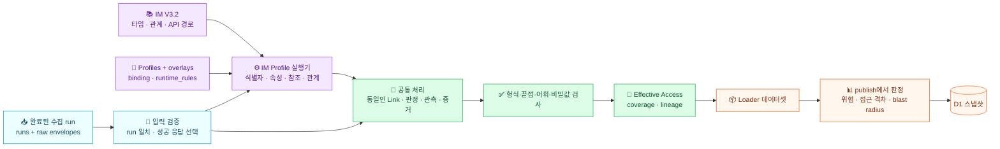

# IM Profile 단일 정규화 파이프라인

현재 상태(2026-10-28, main 2a8931b): 실행기 통합과 이전 디렉터리 제거는 main에 반영됐다. 레지스트리 수집과 실행 병합은 [TOTAL_COLLECTOR](TOTAL_COLLECTOR.md)를 따른다. 문서에 남긴 브랜치명은 구현 이력이다.

정규화는 `npm run normalize`로 IM Profile 실행기만 호출한다. 객체 추출에 손코드 정규화, 카탈로그 정규화 또는 v1 투영을 이어 붙이지 않는다. 이 문서는 `refactor/im-profile-pipeline` 브랜치 및 `refactor/remove-legacy-normalizers`의 구현을 설명한다. 작업 이슈는 [#103](https://github.com/AEGI-Inc/aegi-adapter-engine/issues/103)과 [#110](https://github.com/AEGI-Inc/aegi-adapter-engine/issues/110)이다.



## 실행과 입력 계약

```bash
npm run normalize -- --raw collected --run <완료된-수집-run-ID> --out src/data/aegi_inc_measured_profiles
npm run normalize -- --raw collected --run <완료된-수집-run-ID> --out src/data/aegi_inc_measured_profiles --check
npm run test:profiles
```

- `--raw`, `--run`, `--out`은 필수다. 수집 run의 `finished_at`과 raw 페이지의 provider·call을 검사한다. HTTP 성공 응답만 추출한다. 오류 응답은 객체가 되지 않는다.
- `--model`의 기본값은 sibling Knowledge의 `schema/im-model/model/v3.2`다. `IM_MODEL_DIR`로도 지정할 수 있다. `--overlays`는 기본 보정 폴더를 대체한다.
- 모든 추출·증거·coverage는 지정한 run만 읽는다. 다른 run의 최신 상태나 로그를 자동으로 합치지 않는다. run 사이의 누적 이벤트는 기존 Splunk/D1 흐름이 담당한다.
- 일반 binding은 provider·call·HTTP method·API 경로를 통해 현재 응답에 연결한다. Profile의 명시적 binding 경로와 모델의 검토된 operation 연결을 사용한다. 모델에 남은 과거 raw 파일명으로 현재 페이지를 찾지 않는다.
- `runtime_rules`도 같은 입력 페이지를 읽는다. 이 두 방식은 하나의 Profile 실행기 안의 추출 방식이며 별도 정규화 파이프라인이 아니다.
- `--check`도 추출, 데이터셋 검사, EA lint, OpenLineage 스키마 검사를 모두 수행한다. 출력 폴더를 만들거나 파일을 쓰지 않는다. 검증 실패는 종료 코드 1이다.
- 출력은 원본·모델·Profile 폴더와 겹칠 수 없다. 비어 있거나 기존 IM 데이터셋인 폴더만 허용한다. 이전 손코드/카탈로그/v1 데이터셋은 별도 출력 폴더로 전환한다.

## 출력과 소비자

| 파일 | 역할 |
| --- | --- |
| `manifest.json` | IM 실행기, 모델 버전·위치, source run, 생성 시각 |
| `objects.json`, `relations.json` | Profile 식별자와 타입으로 만든 기본 그래프 |
| `links.json`, `observations.json`, `evidence_links.json` | 공통 처리기가 만든 동일인 연결과 관측 근거 |
| `effective_access.json` | 공통 그래프, 증거 로더로 계산하고 lint한 EA. Loader가 읽는 정확한 이름. EA 를 만드는 함수 하나(`scripts/accessRules/production.ts` `datasetEffectiveAccess`)의 결과를 담아 두는 곳이고, 게시(`--from-current`, `--dataset` 게시 전 견주기)와 검증(`engine:verify`)은 같은 함수로 다시 계산해 견준다 |
| `coverage.json` | 지정한 run의 호출 완결성. 실패·누락을 권한 부재로 확정하지 않기 위한 입력 |
| `lineage_events.json` | OpenLineage 스키마 검사를 통과한 계보와 원본 데이터셋 해시 |
| `runner-report.json`, `verify.json` | 추출 건수, 미해결, 미사용 페이지, 출력 검사 결과. `identity_link_pairs` 는 사람, 자동화 링크 안 계정 쌍을 링크마다 EA 가 잇는 방법으로 나눈 수이고, `blocked` 는 약한 간선 둘 이상이라 잇지 않은 쌍이다(10-29 결정 C2 의 다시 볼 조건, 0 이 아니면 다시 본다). 세다가 실패하면 `status: error` 만 남고 정규화는 멈추지 않는다. 명령줄 출력의 `link_pairs_blocked` 도 같은 수 |

시나리오 바인딩과 기대 정답을 생성하지 않는다. 위협·접근 격차·blast radius는 기존 Loader `computeSnapshot`에서 계산한다. 정규화 명령은 publish, D1 쓰기 또는 SaaS 수집을 자동 실행하지 않는다.

## 제거한 경로와 자립화 범위

`normalize-v2/`, `catalog/`, `normalize/`, `model-v1/` 등 이전 정규화 레거시 구현체와 `catalog:sync`, `catalog:compare`, `test:catalog-parity`, `compare:three-way` 명령을 완전히 제거했다.
공통 처리 기반(`Dataset`, `NormalizeContext`, 동일인 연결, 관측치 빌드, G4 판정, coverage, 온톨로지 매치/조인 등)은 `scripts/collect/shared/`로 자립화하여 이전 코드 없이도 독립 실행되도록 정리했다.
모든 운영 및 테스트 경로는 `scripts/collect/profile-binding/`의 단일 IM Profile 정규화 파이프라인만 사용하며, `guard.test.mjs`의 Legacy Absence Guard를 통해 이전 디렉터리나 레거시 모듈 호출이 완전히 차단되었음을 검증한다.

`verify-collected.mjs`는 2026-10-23 코호트의 고정 기대 건수를 검사하는 과거 회귀 도구다. 일반 실행의 필수 검증은 실행기 안의 `verifyDataset`과 `buildProducts`다. 과거 도구에도 임시 clone 기본값은 없으며 `--raw`, `--run`, `--dataset`을 명시한다.

## 검증 범위

`test:profiles`는 운영 Profile·overlay와 합성 원본으로 객체·관계·EA·coverage·lineage를 만들고 실제 Loader의 위협·blast 계산까지 실행한다. 일반 binding의 새 파일명 연결, 최상위 비밀 필드 제거, HTTP 실패 응답 제외, run 격리, 쓰기 없는 `--check`, 미완료 run 거절을 확인한다. 테스트용 IM 판정 파일은 최소 합성이므로 전체 실측 모델과 모든 1,977개 타입의 정확도는 증명하지 않는다. 보관된 실측 원본은 로컬에서 별도로 재실행했다. SaaS 재수집과 운영 D1 검증은 수행하지 않았다.

검증 결과(2026-10-26): IM Profile 가드 7개, 수집 및 검증 회귀 77개, 탐지 23개, Loader 35개, Splunk 21개가 통과했다 (총 156개 테스트 전체 100% 통과). Mermaid 렌더링도 통과했다. 추가 전체 TypeScript 검사는 기준 main과 작업 브랜치 모두 동일한 기존 진단 381개로 유지되었으며 신규 진단은 없었다.

실측 대조: archive의 v3-readiness 보관본에서 `20261023T070520Z-42c1` raw·run만 로컬로 복원하고, 기준 main `e1f4678`의 기존 IM 실행기와 같은 Knowledge V3.2 모델로 실행했다. 객체 744개·관계 677개·Link 9개·관측 306개·증거 연결 47개가 JSON 객체 필드 순서를 정규화한 비교에서 동일했다. EA 5행은 기존 그래프에서 재계산한 결과와 일치했다. 기존 출력에 동일 run의 EA·coverage를 보충하고 생성 시각을 맞춘 Loader 비교에서 위협 13개·접근 격차 4개·자격증명별 피해범위 39개·집계 7개가 동일했다. 고정 코호트 원본 대조 검사 18개도 통과했다. 개인 데이터와 로컬 출력은 Git에 넣지 않았다.
