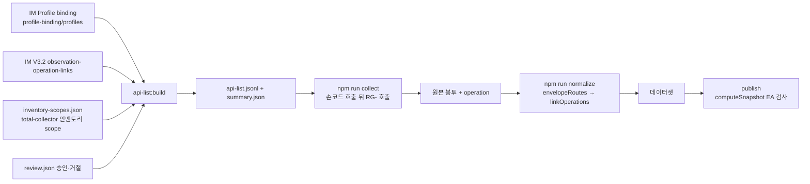

# 수집 API 목록 기반 전수 수집 (total collector)

손코드 호출표(`scripts/collect/providers/*.ts`)가 읽지 않는 IM Profile operation 을 선언형 수집 API 목록으로 모아, 검토해 승인한 것만 기존 수집기로 실행한다. 정규화기는 원본 봉투에 남긴 IR operation 으로 Profile 과 연결한다. 외부 인계본 total-collector(v0.1~v0.6)의 인벤토리 scope 근거, 여러 실행 병합, 게시 전 EA 근거 검사를 이 구조에 옮겼다.

## 요약

| 항목 | 값 |
| --- | --- |
| Profile 이 가리키는 operation | 1,701개 (Profile 1,825개) |
| `legacy` 손코드 호출이 이미 읽음 | 43 |
| `approved` 승인, 실행함 | 749 (Salesforce 506, Okta 92, GitHub 56, Atlassian 45, GWS 36, Slack 14) |
| `candidate` 실행 가능하나 검토 전 | 579 (모두 Salesforce 업무 레코드 객체) |
| `blocked` 막는 규칙에 걸림 | 327 |
| `rejected` 검토에서 거절 | 3 |

수치는 `scripts/collect/api-list/summary.json` 이 원본이다. 승인 749개는 아래 규칙으로 AI 가 1차 판정한 것이다(`review.json` 의 `reason`). 사람이 검토하면 결정과 `reviewer` 를 고친다.

## 흐름



## 파일

| 파일 | 역할 |
| --- | --- |
| `scripts/collect/api-list/sources.ts` | IR 출처마다 호스트, 자격증명, 페이지 방식, GWS scope. 호스트는 이 표에서만 나온다. `trustedHost` 가 만든 주소를 한 번 더 확인한다 |
| `scripts/collect/api-list/params.ts` | 경로 변수 값: 설정 값(`github.org`), 고정 값(`my_customer`), 같은 실행의 부모 목록(fanout, 예: OK-07 앱 id), 부모 페이지 묶음(`fanoutTuples`) |
| `scripts/collect/api-list/build.ts` | Profile 에서 operation 을 모아 상태와 사유를 정한다 |
| `scripts/collect/api-list/review.json` | 승인·거절 결정. 이 파일에 없는 후보는 실행하지 않는다 |
| `scripts/collect/api-list/import-inventory.ts` | total-collector 인벤토리(`*_operations.jsonl`)에서 Profile operation 의 문서상 scope 를 가져온다 |
| `scripts/collect/providers/apiList.ts` | 승인 항목을 `CallDef` 로 만든다 (ID `RG-<접두사>-<operation>`) |
| `scripts/collect/merge.ts` | 여러 실행을 정규화용 실행 하나로 합친다 |

## 상태를 정하는 규칙 (`build.ts`)

순서대로 처음 걸린 규칙이 사유가 된다.

1. 손코드 호출이 이미 읽음(모델의 실측 연결 또는 Profile `binding.call`): `legacy`
2. `runtime_rules` Profile, `non_object`: 수집 API 목록에 넣지 않음
3. 출처가 표에 없음 `source_not_in_registry_table`, 출처가 막힘(별도 호스트, 최종 사용자 문맥, 조직 관리 키 없음 등)
4. GET 이 아님 `method_*`, 경로 없음 `no_endpoint_template`
5. Slack RPC 가 읽기 메서드가 아님 `rpc_not_read_method`, 내용 본문 RPC(files, chat 등)
6. GitHub 본인 문맥 API `user_context_api`
7. GWS scope 를 모름 `gws_scope_unknown`
8. 내용 본문 경로(메시지, 댓글, 페이지, 첨부, 이력 등)나 Salesforce 내용 객체(EmailMessage, Feed 등) `content_bearing_endpoint`
9. 경로 밖 필수 인자 `required_argument:*`, Profile identity 가 쓰는 `$req.<이름>` 을 실행이 줄 수 없음 `identity_needs_request_param:*`(정규화기 규칙: 경로 변수, 요청 값, 경로의 부모 변수로 채우는 parent_id), 값을 얻을 수 없는 경로 변수 `unresolved_param:*`(아래 「경로 변수 해석」으로도 못 푼 것)
10. 남은 것은 `candidate`. `review.json` 에 승인이 있으면 `approved`, 거절이 있으면 `rejected`. 막힌 항목의 승인은 무시하고 사유에 남긴다

Salesforce 권한 세트·프로필의 내용 행(FieldPermissions, ObjectPermissions, PermissionSetTabSetting, SetupEntityAccess, OrgEmailAddressSecurity: `ParentId` 가 PermissionSet·Profile)은 수집하되 객체로 만들지 않는다. 판단표 G4-Q02 와 그 세부 규칙(aegi-knowledge `docs/decisions/SALESFORCE_PERMISSION_ROWS_2026-10-28.md`)대로 부모 권한 세트의 `permissions` 속성에 접는다. 프로필 소유 권한 세트의 행은 그 Profile 객체에 접는다. 접는 규칙은 `profile-binding/overlays/salesforce/` 다섯 Profile 의 enrich 규칙 `fold` 다. 이 Profile 들은 `runtime_rules` 를 갖지만 출처가 모두 수집 API 목록 호출(`RG-`)이라 수집 API 목록에 남는다(`build.ts` 의 `readsOnlyApiList`). 2026-10-27 실측에서 이 다섯 타입을 객체로 만들었을 때 객체 11,000여 개가 생기고 관계는 하나도 생기지 않아 2026-10-28 에 한때 거절했다. 두 객체를 잇는 행(PermissionSetGroupComponent, SessionPermSetActivation 등)은 Assignment 라 남긴다.

1차 판정은 위 규칙을 통과한 Okta, GitHub, GWS, Atlassian, Slack 후보를 모두 승인했고, Salesforce 는 설정·권한 인터페이스(Assignment, Policy, Automation, Integration, Endpoint, Principal, Credential)를 가진 객체만 승인했다. 업무 레코드 객체 579개는 후보로 남겼다.

## 경로 변수 해석

경로 변수(`{appId}` 등)마다 값을 어디서 얻는지 정한다. 순서대로 처음 맞는 것을 쓴다.

1. 설정·고정 값: `{org}` → `github.org`, `{customer}` → `my_customer` (`params.ts` 표)
2. 손코드 호출 표: `{appId}` 앞 조각 `apps` → OK-07 의 `id` (`params.ts` 표, 변수가 하나일 때)
3. 부모 목록 operation: 표에 없거나 변수가 여럿이면 마지막 변수 앞까지 자른 경로(`/a/{x}/b/{y}` → `/a/{x}/b`)와 모양이 같은 같은 SaaS 의 GET 목록 operation 을 찾는다. 손코드 호출(legacy) 이든 수집 API 목록 호출이든 된다. 검토에서 거절된 목록은 쓰지 않는다. 부모가 풀려야 자식이 풀리므로 바뀌지 않을 때까지 반복한다.
   - 값 필드는 차례로 본다: 변수와 같은 이름(`matterId`), 단수형(`devicesId` → `deviceId`), 이름 힌트(`pull_number` → `number`, `*_sha` → `sha`, `*Name` → `name`), 부모 Profile identity 필드, `id`.
   - 앞 변수는 부모 페이지의 요청 값에서 이어받는다(중첩 fanout). 예: `/screens/{screenId}/tabs/{tabId}/fields` 는 tabs 목록 페이지의 `screenId` 요청 값과 그 항목의 `id` 를 묶는다. 손코드 호출은 `userId` 를 `user` 처럼 Id 를 뗀 이름으로 남겨서 그 이름도 본다.
   - 부모 페이지는 주소가 부모 경로와 맞는 것만 쓴다(손코드 호출 하나가 여러 경로를 부르는 경우).
   - Google 자원 이름(`devices/abc`)은 마지막 조각만 쓴다.
4. Google Discovery 의 필수 인자 `parent`, `name` 은 경로(`customers/{customersId}`)를 이어 붙인 자원 이름이라 경로가 채워지면 정해진다.

실행 때는 부모가 수집 API 목록 호출이면 부모가 먼저 돌도록 줄을 세운다(`orderByParent`). 2026-10-28 에 이 규칙으로 145개 중 54개를 풀어 53개를 승인하고 1개(Cloud Identity 그룹, 부모 값 불일치)를 거절했다. 실측에서 데이터가 들어온 것은 8개이고, 23개는 부모가 비었거나 403 이었다(테넌트에 그 자원·기능이 없음).

## 실행할 때 (`providers/apiList.ts`)

- 손코드 호출이 모두 끝난 뒤에 돈다. 부모 목록은 그 호출이 이번 실행에 저장한 페이지에서 읽는다(`CallApi.collected`). 부모가 없으면 `partial(no_parent_values:<호출>)`, 200개를 넘으면 앞 200개만 부르고 `partial(fanout_limit:200)`.
- HTTP·API 오류는 401 을 포함해 모두 그 호출만 `partial` 이다. 탐색 operation 의 401 은 기능·라이선스 게이트(Copilot 전용 API, Forge 전용 속성, Okta 기능 미사용)인 경우가 많았다. Salesforce 는 사유에 `sf_<errorCode>`(예: `sf_INVALID_TYPE`: 이 조직에 없는 객체)를 남긴다.
- 인증 오류는 요청이 아니라 호출 단위로 센다. 성공 없이 인증 오류로만 끝난 수집 API 목록 호출이 같은 SaaS 에서 5번 이어지면 남은 수집 API 목록 호출은 `skipped(auth_failures:5)` 다. fanout 호출 하나가 성공 없이 인증 오류를 5번 받으면 남은 부모를 부르지 않는다. 토큰 발급 실패(TokenError)는 기존대로 그 SaaS 를 멈춘다.
- 수집 API 목록 호출이 손코드 뒤에 돌아 손코드 호출에는 영향이 없다.
- scope: Okta 는 문서가 적은 scope 중 하나라도 `config.okta.scopes` 에 있어야 하고, GWS 는 DWD 기본 허용 목록 또는 `config.gws.grantedScopes` 에 있어야 한다. 없으면 `skipped(scope_not_granted:…)`.
- 설정 값이 비면 `skipped(config_missing:…)`, 호스트 자격증명이 없으면 `skipped(host_not_configured:…)`.
- Salesforce 는 `SELECT FIELDS(STANDARD) FROM <객체>` 조회다. 그 전에 `RG-SF-describeGlobal` 이 조직의 sObject 목록(`/sobjects`)을 한 번 받는다. 목록에 없는 객체는 `skipped(object_not_in_org:<객체>)`, 조회할 수 없는 객체는 `skipped(object_not_queryable:<객체>)` 로 부르지 않는다. 이름은 대소문자를 가리지 않고 맞춘다. 목록을 받지 못하면 거르지 않고 모두 부른다. 원본에는 객체 이름과 조회 가능 여부만 남긴다. 2026-10-30 2회차 조직에서 승인 517개 중 295개(전에는 `sf_INVALID_TYPE` partial)가 걸러졌고 받은 레코드는 같았다.
- 원본 봉투에 `operation: { id, path_template, registry_id }` 를 남긴다. 손코드 호출 봉투는 바뀌지 않는다.

정규화기(`runner/input.mjs envelopeRoutes`)는 이 선언으로 경로를 만들지만 두 조건을 모두 통과해야 연결한다.

- 지금 `api-list.jsonl` 에서 승인된 (호출 ID, operation) 이어야 한다. 수집 뒤 거절한 operation 의 원본은 연결하지 않는다.
- 기존 `matchesOperation`(메서드, 경로 틀, Slack 메서드, Salesforce 객체)을 통과해야 한다. 선언이 실제 주소와 다르면 아무것도 연결되지 않는다. Salesforce SOQL 다음 쪽(`/query/<커서>`)은 같은 질의로 본다.

## 명령

```bash
npm run api-list:build                         # Profile·모델·검토 결과로 api-list.jsonl, summary.json 을 다시 만든다 (aegi-knowledge 필요)
npm run api-list:build -- --check              # 최신인지만 확인 (모델 폴더가 없으면 건너뜀)
npm run api-list:import-inventory -- <폴더>     # total-collector 인벤토리에서 scope 근거를 다시 가져온다
npm run collect                                # 손코드 호출 + 승인된 수집 API 목록 호출
npm run collect -- --no-api-list               # 손코드 호출만
npm run collect -- --list                      # 실행할 호출과 건너뛸 이유 (네트워크 없음)
npm run collect -- --calls OK-07,RG-OK-listApplicationKeys   # 부모 호출과 함께 골라 실행
npm run collect:merge -- --runs <run1>,<run2> --out-run <새 ID>   # 호출마다 실행 하나를 골라 합친다
```

`collect:verify` 는 기본으로 손코드 호출만 기대 목록에 넣는다. 수집 API 목록 호출까지 보려면 `--calls` 로 `RG-` 호출을 적는다. 수집 API 목록 호출은 탐색이라 `partial` 이 흔하고, 이는 실패가 아니라 권한·플랜 사유다.

## 여러 실행 병합 (`collect:merge`)

정규화기는 실행 하나만 읽는다. 수집 API 목록만 다시 돌린 실행을 이전 실행과 함께 쓰려면 합친다.

- 호출마다 실행 하나만 고른다. 기준은 `shared/raw.ts RawSet` 과 같다: full·partial 로 끝난 가장 최근 실행, 없으면 가장 최근 기록. 서로 다른 실행의 같은 호출 페이지를 섞지 않는다. 로그 스트림도 가장 최근 실행 하나만 쓴다.
- 원본 페이지는 바꾸지 않고 복사한다. 호출 기록의 `run_id` 는 합친 실행 ID 이고, 어느 실행에서 왔는지는 실행 기록의 `args.merge.chosen` 에 있다.
- 이미 있는 실행 ID 에는 쓰지 않는다.

## 게시 전 EA 검사

`scripts/loader/engine.ts computeSnapshot` 이 데이터셋의 `effective_access.json` 행마다 끝점 객체, via 관계(끝점과 어휘까지), via 링크 간선이 같은 데이터셋에 있는지 본다(`danglingEffectiveAccess`). 없으면 게시와 `d1:verify` 가 멈춘다. 다른 시점 자료를 섞은 데이터셋을 막는다(인계본 README 의 measured_v2 사례). 규칙 형식 검사(`lintEffectiveAccess`)는 정규화가 한다. 게시에서 다시 하면 규칙이 바뀐 뒤 옛 데이터셋을 `--from-current` 로 다시 게시할 수 없다.

## 확인한 것

- `test:collect`(수집 API 목록 규칙, fanout, 봉투 operation, partial, 인증 오류 횟수, scope, 호스트, 선택, 저장본 일관성, 병합), `test:profiles`(봉투 operation 연결, 승인 필터, SOQL 다음 쪽), `test:loader`(EA 검사) 통과.
- 수집 API 목록 페이지가 없는 기존 실측 실행을 이 브랜치와 main 정규화기로 각각 돌려 objects, relations, links, observations, evidence_links 가 바이트 단위로 같았다.

## 실측 결과 (2026-10-27, 읽기 전용, 게시 안 함)

전체 수집 1회(손코드 + 수집 API 목록) 뒤 Okta, GitHub 만 다시 수집하고 `collect:merge` 로 합쳐 정규화했다.

| SaaS | 수집 API 목록 호출 (full / partial / skipped) | 수집 API 목록에서만 나온 객체 | 새 타입 |
| --- | --- | --- | --- |
| Salesforce | 148 / 358 / 0 | 11,776 | 41 |
| Atlassian | 30 / 11 / 0 | 116 | 18 |
| Okta | 14 / 38 / 14 | 50 | 6 |
| GWS | 3 / 5 / 13 | 10 | 2 |
| GitHub | 9 / 18 / 21 | 2 | 1 |
| Slack | 0 / 14 / 0 | 0 | 0 |

- 정규화: 객체 13,136(손코드만 쓰면 약 1,180), 타입 163, 관계 634, identity 거부 0, 검증 통과. `collect:verify` 는 손코드 호출의 원래 partial·failed 만 보고했다.
- partial 의 대부분은 테넌트 사실이다: Salesforce `sf_INVALID_TYPE` 353(이 조직·에디션에 없는 객체), 403 54(Okta AI·IGA 기능, GitHub 조직 설정), Slack 토큰 종류·인자.
- 관계는 거의 늘지 않았다. 새 Salesforce 권한 객체(FieldPermissions, ObjectPermissions 등)의 참조는 `no_relation` 이고, 대상 PermissionSet 중 프로필 소유분은 Profile 객체로 만들어져 참조 9,600여 건이 `target_value_not_collected` 로 남았다. 2026-10-28 에 이 행들을 객체 대신 `permissions` 속성으로 접도록 바꿨다(「상태를 정하는 규칙」 절). 병합 run(2026-10-28)에서 11,399행 중 10,761행이 권한 세트 45개, Profile 19개에 접혔고, 부모 권한 세트가 SF-04 에 없는 638행은 접지 않고 실행 보고서 `relation_rules.enrich` 에 센다.
- 실측에서 고친 것: 401 로 SaaS 전체가 멈춤(105개 skipped), SOQL 다음 쪽 미연결(FieldPermissions 6,011 중 1,818만 객체화), 정적으로 알 수 있는 identity 불가 operation 5개, Profile 결함 operation 2개 거절(Jira features 경로, GitHub branch protection identity).

## 남은 것

- 사람 검토: `review.json` 의 1차 승인 확인, Salesforce 후보 579개 판단.
- aegi-knowledge: 이름이 `parent:user/{}` 인 Atlassian 타입 정리. 거절했던 2개 operation(Jira features 경로, GitHub branch protection identity)은 2026-10-28 engine 보정(`overlays/jira`, `overlays/github`)으로 고쳐 다시 승인했다.
- Salesforce 권한 내용 행의 부모 권한 세트 10개가 SF-04(`FROM PermissionSet`)에 없는 이유 확인.
- 막힌 출처: GraphQL 질의 문서, Okta 별도 제품 호스트(OPA, ASA), Atlassian 조직 관리 키, `github.enterprise` 설정(21개 skipped).
- 경로 변수를 못 푸는 operation 87개(2026-10-28 Okta authenticators·policies 를 손코드 목록으로 풀어 줄었다): 중간 단계 목록 operation 이 IM Profile 에 없다(예: `/labels/{id}/revisions/{rid}/locks` 의 revisions 목록). aegi-knowledge 에 목록 Profile 이 생기면 `api-list:build` 가 자동으로 푼다.
